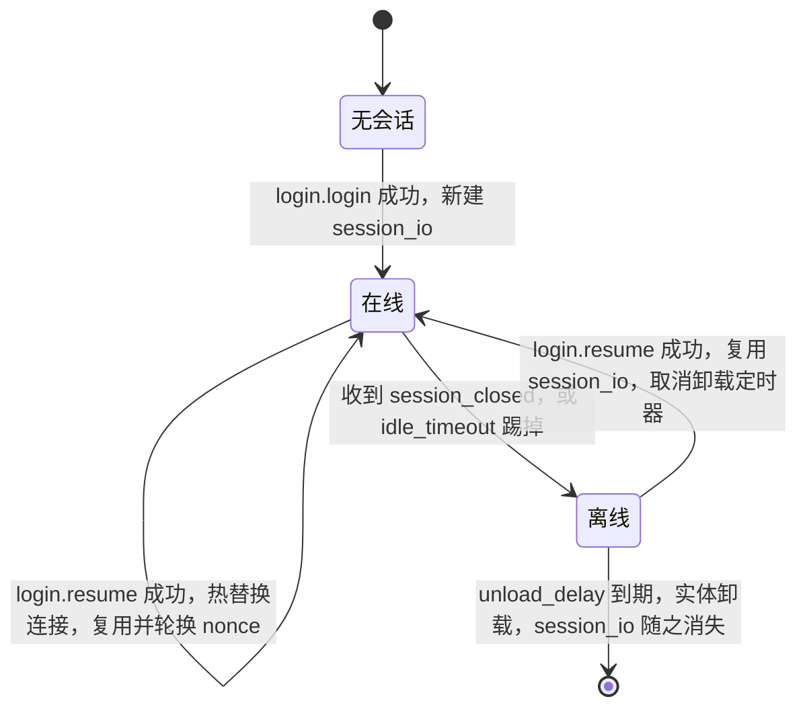
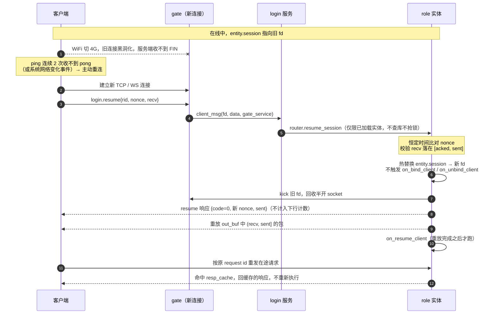

# 会话续接与 WS/WSS 接入

> **这是内部设计文档，不发布到文档网站**（`docs/_sidebar.md` 不收 `design/`）。它记录的是决策和取舍，面向改这块代码的人。
> 面向用户的文档等实现跑通之后另写，见文末「要改的文件」里「实现跑通之后再写」那一行。

## 为什么要做

现在的会话标识是 `"<gate_node>/<fd>"`（`lualib/skyext/entity/session.lua:24`），**整个会话的身份就是一个 TCP fd**。连接一断，网关（`service/session_gate.lua`，下文统一按改名后的 `gate_tcp` 称呼）立刻删表并通知实体 `session_closed`，实体解绑、起卸载倒计时。客户端除了「重连 + 走一遍完整登录」没有别的选择，断线瞬间在途的请求回包和服务端推送全部丢失。

现状是把这件事外包给了 `example/tools/goscon`：它在 TCP 层做字节级流续接，顺带把浏览器的 WebSocket 转成裸 TCP。代价是多一跳进程、多一个 Go 运行时、客户端真实 IP 要靠 `login.report_remote_addr` 这种补丁绕回来。

这份设计把两件事收回框架内：

1. **会话续接**：断线重连后续上原来的会话，不丢不重。
2. **WS/WSS 原生接入**：小程序和浏览器直连网关，不再需要 goscon 转一道。裸 TCP 网关同时保留给原生 APP，两者同等重要。

明确**不做**：不做 KCP，不做 SCP 那样的字节级重放（见 `docs/non-goals.md`）。目标品类（SLG / 卡牌 / 放置 / 休闲 MMO）是请求应答型的，包级续接够用；字节级和 KCP 都要求我们在每个客户端平台上自己维护一份实现，不划算。goscon 必须做字节级是因为它是个不许看懂协议的透明代理——那是它的约束，不是优点，续接逻辑进了框架这个约束就消失了。

## 三个决定性判断

整个设计是这三条推出来的，先讲清楚，后面都是细节。

### 判断一：续接状态属于实体，不属于网关

`service/gate_tcp.lua`（现 `session_gate.lua`）的文件头自己写着「**只管连接，不持有玩法状态**」。把续接凭据、重放缓冲、宽限计时器放进网关会推翻这条原则，还带来一个硬伤：**续接只能回到同一个网关节点**，前面挂 LB 或 CDN 就失效。

实体才是对的位置——它本来就是集群内唯一的、带分布式锁的玩家属主，而连接是易失的那一侧。放到实体上之后：

- **续接复用已有路由**。`router.resume_session` 是 `router.bind_session` 的孪生兄弟，沿用 HRW 寻址、跨节点 handoff、锁。客户端落到哪个网关、实体在哪个节点，都无所谓。
- **计时器从三个塌缩成一个**。实体的 `unload_delay`（300s，`example/etc/nodes/common.app.lua:128`）**本身就是续接窗口**，不需要再引入 `resume_window`，也就没有「两个窗口怎么对齐」这个问题——那个问题是设计出来的，不是固有的。
- **网关保持哑管道**，两种传输（TCP / WS）都只是薄适配层，没有重复的语义实现。

代价：实体要为重放缓冲付内存，靠 `session_replay_bytes` 封顶（默认 32KB/人）。

### 判断二：包头零改动——seq 不上线

TCP 和 WebSocket 都保证**连接内有序、不丢、不半包**：一个包要么完整到达，要么连接断掉。在一条已经可靠有序的信道上传序号是多余的，两端**各自计数**即可：

- 服务端维护 `sent`，客户端维护 `recv`
- 断线时两边计数可能不一致（发出去但没到），这正是续接要解决的
- 续接请求把客户端的 `recv` 带上，服务端从 `recv + 1` 开始重放
- 服务端裁剪缓冲需要的 ack，坐在周期性心跳上，不占每个包

所以**不需要传输层信封，也不需要动 `base.sproto`**。每包开销 0 字节。

这是全文最不常规的一条，但有直接先例：**Socket.IO 的 connection state recovery** 就是这个模型——offset 只在重连握手时带上，不随每个包走。MQTT / QUIC 之所以每包带序号，是因为它们跑在不可靠或多路复用的底座上（QUIC 自己就是传输层）；我们跑在已经可靠有序的 TCP / WS 单流上，那个前提不成立。Phoenix Channels 更激进，重连后只 rejoin + 全量重同步，连重放都不做。

这一条推翻了本设计早期版本里的 9 字节信封，以及「把 seq/ack 塞进 `ud`」的方案。顺带记下当时查到的两个约束，免得以后有人重走一遍：

- `skynet/lualib/sproto.lua:181-250` 的 `host` 把包头字段写死成 `type` / `session` / `ud` 三个，`header_tmp` 还是模块级共享可变表。给 `base.sproto` 加平级字段，**解码侧能收到但会留脏值，编码侧根本没地方设**。想加平级字段就得 skyext 自己写一份 host（约 50 行，`sproto.queryproto`、`sproto.pack/unpack`、`sp:encode/decode` 都是公开的，不用 patch submodule）。
- `ud` 改成结构体则**不用自写 host**（attach / gen_response / dispatch 对它原样透传 table），但线上要 ~10 字节（2 tag 槽 + 4 长度 + 4 子结构），和信封一样贵。
- 整数字段值 `< 0x7fff` 才内联进 2 字节 tag 槽（`skynet/lualib-src/sproto/sproto.c:1002-1006`），超过跳到 10 字节。所以真要上线序号，必须在 15 位内回绕。

**`ud` 直接删掉。** 它在整个代码库里零引用（`sproto_api.lua:246` 的 `dispatch` 连第 5 个返回值都没接），而本设计确认不需要它。保留一个「将来也许能放 trace id」的未用字段是投机设计——没有兼容包袱时，将来真要加的代价和现在一模一样，那就不要现在加。删掉之后 `header.ud` 恒为 nil，skynet 的 host 对此完全正常（`header_tmp.ud = nil` 等于不设该键，编码不会报错）。

顺带把 `login.sproto` 的协议号重编：删掉 `report_remote_addr 100` 之后，`login` / `resume` / `ping` 排成 100 / 101 / 102，不留空洞。没有线上客户端要迁就，这种事就该现在做干净。

### 判断三：续接不走 `login`

`login_request.lua:54-111` 的登录路径会跑 JWT 校验 → proto checksum → `realm.server` → **`role_db_api.has_role` 一次 MongoDB 查询**。断网恢复时往往是一批客户端同时重连，把数据库打在最脆弱的时刻是明显的坏设计。而且用「某个字段有没有值」分流出两套语义，响应里一半字段对另一半路径无意义。

所以是独立协议，**不验 JWT、不查库**，凭据是 nonce：

- nonce 是 16 字节随机数，实体在 bind 时生成，续接时实体做恒定时间比对
- `rid` 只用于路由，伪造它没有任何收益
- **凭据范围更小更安全**：access token 代表整个账号；nonce 只代表一条会话，最长活到 `unload_delay`。偷到 nonce 等价于偷到那条连接，偷到 token 要严重得多。用 nonce 是最小权限，不是更弱

**但有一个必须守住的边界：`resume` 不得触发实体加载。** `router.bind_session` 走的是 `entity_agent.lua:207` 的 `try_ensure_loaded`——会查库、抢锁、必要时跨节点 handoff。`resume_session` 如果照抄这条路，就等于开放了一个**不需要任何认证**的接口，拿一串 rid 就能让集群把任意玩家的实体从库里加载起来、抢锁、甚至触发 handoff，是现成的放大攻击面。

所以 `resume_session` 只能作用于**已在内存中的实体**：寻址到目标节点后直接查本地实体表，不在就返回失败。这不是额外限制——`session_io` 本来就只活在内存里，实体不在内存意味着续接状态早已不存在，续接必然失败。认证（nonce 比对）之前不做任何有代价的操作。

## 分两档交付

| | 解决什么 | 成本 |
|---|---|---|
| **Tier 1** 会话存活 + 上行幂等 | 重连不用重新登录；请求不会被执行两次（扣费、抽卡） | `login.resume` + `login.ping` 协议 + 实体上一个响应缓存 |
| **Tier 2** 下行重放 | 断线期间的服务端推送不丢 | 每人一个有上限的环形缓冲 + `ping.recv` 的确认语义 |

Tier 1 必做，收益明确。Tier 2 看推送有多重要——如果客户端重连后本来就要拉一次全量状态（多数游戏如此），它的边际收益比看上去小。

两档共用同一套会话状态，Tier 2 可以后加，不返工。前提是**协议字段一次定义到位**：`resume.recv` / `resume.sent` / `ping.recv` 从第一天就写进 `.sproto`，Tier 1 阶段两端填 0 并忽略。协议加字段要全客户端跟版本，留到以后加代价高得多。

## 协议

```
# 续接。不验 token、不查库，失败时客户端退化成 login.login
resume 101 {
    request {
        rid 0 : integer      # 仅用于路由
        nonce 1 : string     # 16 字节续接凭据
        recv 2 : integer     # 客户端已收到的包数（Tier 2）
    }
    response {
        code 0 : integer
        nonce 1 : string     # 轮换后的新凭据
        sent 2 : integer     # 服务端已发出的包数，供客户端自检（Tier 2）
    }
}

# 心跳。客户端每 15s 或未确认积压超过 64 包时发。
# 协议属于 Tier 1（空闲超时和客户端侧断线检测都要靠它），
# recv 字段只有 Tier 2 才有意义，没做 Tier 2 时客户端填 0、服务端忽略。
#
# 必须是请求/响应而不是单向：单向心跳只让服务端知道客户端活着，
# 客户端自己无从判断连接是不是已经黑洞了（见「断线检测」一节）。
ping 102 {
    request {
        recv 0 : integer
    }
    response {
        sent 0 : integer   # 服务端已发出的包数，供客户端自检
    }
}
```

`login.login` 的响应加一个 `nonce` 字段，把首次登录的续接凭据发下去。**nonce 每次 bind / resume 都轮换**，用过的立即失效，避免被重放。

## 实体侧状态



**`session_io` 才是「会话」，`entity.session` 只是它当前挂在哪条连接上。** 上图里「在线 → 在线」那两条自环是最容易写错的地方：同样是收到一条登录类协议，`login` 必须重建、`resume` 必须复用。

```lua
entity.session    = { gate_node, gate_service, fd }  -- 连接在线时才有，断开即 nil
entity.session_io = {                                 -- 从首次 bind 活到实体卸载
    nonce,       -- 当前续接凭据
    sent,        -- 已发出的包数
    acked,       -- 客户端已确认到的包数
    out_buf,     -- (acked, sent] 区间的下行包，有上限的环形缓冲
    resp_cache,  -- request id -> 已编码的响应，上行去重用
    last_seen,   -- 最后一个上行包的时间，空闲超时用
    unresumable, -- 缓冲溢出后置位
}
```

`session_io` 跨连接存活，**它才是「会话」**；`session` 只是它当前挂在哪条连接上。实体卸载时 `session_io` 一起消失，所以续接窗口天然等于 `unload_delay`，不需要单独的计时器。

实体因失租、卸载而消失的情况，天然落在「`session_io` 没了 → 续接失败 → 退化成登录」，**不需要额外的销毁通知机制**。

**生命周期规则（必须严格执行，否则会串号）：**

| 入口 | 对 `session_io` 的处置 |
|---|---|
| `login.login` 成功 | **无条件丢弃旧的、新建一个**：新 nonce、计数清零、缓冲和响应缓存清空 |
| `login.resume` 成功 | 复用现有的，只轮换 nonce |

第一条是硬要求。`entity_agent.lua:206` 的 `CMD.bind_session` 在实体已有会话时会 `unbind_kick(old.key)` 再绑新的——**顶号和同账号重登走的就是这条路，实体对象没变，`session_io` 也就还在**。如果不重建，后来者会继承前一个客户端的 nonce（能冒充续接）、下行计数（重放错位）和响应缓存（读到别人的回包）。这是「实体长寿、连接易失」这个结构天然带的坑，必须在 `bind_session` 里显式处理。

## 不丢不重

### 上行去重（Tier 1）

sproto 的 `base.package` 已经有 `session` 字段当 request id（`example/proto/base.sproto:3`），客户端 `M.call` 用单调自增的 session 发出（`lualib/skyext/sproto_api.lua:255`）、服务端由 `g_host:dispatch` 还回来的 `response_cb` 原样写回（`:246`）。直接拿它当幂等键：

- 实体收到请求，先查 `resp_cache[session]`，命中就直接回缓存的响应，**不重新执行**
- 未命中则正常执行，把编码后的响应存进缓存
- 缓存保留最近 64 个 request id，够覆盖一次断线窗口内的在途请求
- 它存的是**编码后的响应字节**，和 `out_buf` 是两份独立内存。按人头算上限时两者都要算进去，`session_replay_bytes`（32KB）之外再给 `session_respcache_bytes`（默认 16KB），超限按 LRU 丢最旧的
- **淘汰之后不能静默重新执行。** 同时维护一个 `min_cached_req_id`：收到的 request id 小于它且不在缓存里，说明这是一个已经被淘汰的重试，**返回明确错误码，不执行**。对扣费 / 抽卡这类操作，「悄悄执行第二遍」比「报一个错让客户端重新走流程」危险得多。实践中不会触发——续接后客户端重试的是最新的几个在途请求，不是很旧的

**规则：客户端的 request id 计数器不能跨续接复位。** 完整登录时可以从头开始（新 `session_io` = 空缓存）。

去重做在会话层，所以**业务代码一行都不用改**，不需要逐协议设计幂等。

**边界**：不带 request id 的单向上行消息无法去重，也无法补发。要紧的操作一律用请求/响应，这条要写进客户端接入文档。

### 下行重放（Tier 2）

- `session.push` 给每个包 `sent = sent + 1` 并存进 `out_buf`；在线就同时写网关，不在线就只入缓冲
- `push` 的返回值因此不再表示「在线」，业务代码改用 `session.is_online(entity)`
- 这同时修掉了现在 `CMD.push` 在 fd 不存在时静默丢包的问题（`service/gate_tcp.lua:107-113`）
- 客户端用 `ping.recv` 确认，实体裁剪 `out_buf`
- 上限 `session_replay_bytes`（32KB）/ `session_replay_packets`（256），任一超限置 `unresumable`，后续续接退化成完整登录。对应 goscon 的 `SCPStatusNotAcceptable 406`

**缓冲只在心跳时裁剪**，所以要能存下一个心跳周期的下行量。推送很密的游戏调高心跳频率或调低积压阈值——这是调参旋钮，不是设计缺陷。

### 计数的三条实现铁律

隐式计数的代价是**会失同步**：任何一边多数或少数一个包，重放就错位。靠三条规则避免，必须写进代码注释：

1. **计数从 `session_io` 创建时的 0 开始**，不是每条连接重置。登录阶段（bind 成功之前）的包两边都不计。
2. **服务端只在 `session.push` 这一个收口处计数**，且每个计数的包都必须入缓冲。任何绕过它写客户端的路径都会失同步。
3. **客户端在收到时计数，在分发之前**。这样解码失败（比如协议热更不匹配）不会导致失同步。

### 自校验

隐式计数不自带校验，补一个便宜的：`resume.recv` 和 `ping.recv` 都让实体核一遍必须落在 `[acked, sent]` 区间内，`resume` 的响应回 `sent` 让客户端反向核。对不上就拒绝续接、退化成完整登录。**一致性检查放在低频路径上，不为它在每个包上付钱。**

## 续接流程



1. 客户端断线。**如果服务端察觉到了**（收到 FIN/RST），网关发 `session_closed`，实体 `session.unbind` 清掉 `entity.session`、**保留 `session_io`**、起 `unload_delay` 倒计时。切换网络时服务端往往察觉不到，旧连接保持半开，这条流程直接跳到第 2 步。
2. 客户端重连到**任意**网关，发 `login.resume{rid, nonce, recv}`。
3. 登录服务不做任何校验，直接 `router.resume_session("role", rid, gate_node, gate_service, fd, nonce, recv)`。
4. 实体校验：`session_io` 还在、nonce 恒定时间比对通过、未置 `unresumable`、`recv` 落在 `[acked, sent]` 内。任一不满足 → 返回错误码，客户端退化成 `login.login`。
5. 通过：把会话**热替换**到新连接（旧连接可能还半开着，见下一节）、取消卸载倒计时、轮换 nonce，回 `{code=0, nonce, sent}`，**重放 `out_buf` 中 `(recv, sent]` 的包，重放完成后**才跑 `on_resume_client`。

**第 5 步的顺序不能动，否则下行会乱序。** 两个坑：

- `on_resume_client` 里业务多半会推一些状态。如果它在重放之前跑，这些新包会抢在旧包前面到达，客户端的计数和实际顺序就对不上了。所以**先重放，后回调**。
- 更稳妥的是在 bind 到重放完成之间置一个 `replaying` 标志：期间 `session.push` 照常计数入 `out_buf` 但**不直接写网关**；重放时统一按序把 `(recv, sent]` 全部发出（天然包含期间新入的包），然后清标志。这样即使有别的协程在这个窗口里推送，顺序也不会错。

**`resume` 的响应本身不计入下行计数。** 它属于续接握手，和 `login` 的响应一样处在计数边界之外；若把它算进去，客户端会在收到重放的旧包之前先把计数加一，自校验立刻失配。实现上它不走 `session.push`，直连当前 fd 发出。

**但响应和重放之间没有顺序保证，客户端必须两种顺序都能处理。** 续接请求是登录服务收的，响应由登录服务直接写 socket；重放是实体进程发的，跨节点时走 `cluster.send` 到网关。`cluster.call` 的响应和 `cluster.send` 的推送走的是**两条不同的 TCP 连接**，谁先到达取决于两条链路的实时状态。想保证顺序就得让响应绕一圈从实体发回来，为一条每次重连只发一次的消息付这个复杂度不值得。

所以真正的保证只有一条：**重放流内部旧包在前、新包在后**，由 `replaying` 标志保证。`resume` 的响应靠 request id 认领，又不计数，早到晚到都不影响对账——客户端只要不假设「收到响应之后才会有重放包」就行。这一条要写进客户端接入规范。

## 断线检测与连接热替换

续接能不能真的用上，取决于两个常被忽略的细节。WiFi 切 4G 是把它们同时暴露出来的场景。

### 断线检测：客户端必须自己发现

WiFi 切 4G 时旧连接通常**不会**收到 FIN 或 RST，它直接变成黑洞：两边的 socket 都还是 ESTABLISHED，写进去不报错，就是再也没有回音。操作系统要等 TCP 重传耗尽才告诉应用层，可能是几分钟。

所以：

- **客户端侧**：靠 `login.ping` 的**响应**。连发 N 次（建议 2 次，即 30s）收不到 pong 就主动关掉 socket 重连，不等操作系统。这是 `ping` 必须是请求/响应的唯一原因——单向心跳只服务于服务端，客户端拿不到任何信号。原生客户端还应同时监听系统的网络变化事件（iOS Reachability / Android ConnectivityManager），拿到通知就立刻重连，不用等 30s
- **服务端侧**：靠 `session_idle_timeout`（60s）看 `last_seen`

两边的检测是独立的，谁先发现谁先动，不需要对齐。

**`ping` 的响应不计入下行计数**，和 `resume` 的响应一样属于传输层握手。否则每 15s 往 `out_buf` 里塞一个没用的包。

### 连接热替换：新连接来时旧连接还活着

这是 WiFi 切 4G 特有的形态：客户端 2 秒内就在新网络上重连了，而服务端**压根还不知道旧连接已经死了**——没收到 `session_closed`，`entity.session` 还指着那个半开的 fd。

于是 `resume` 要做的不是「绑定一条新连接」，而是**把会话从旧连接热替换到新连接**：

1. 记下 `old = entity.session`
2. `entity.session` 直接指向新的 `{gate_node, gate_service, fd}`，`g_sessions` 同步换键
3. 对旧 fd 发一次 `kick`，回收那个半开 socket
4. **不触发 `on_unbind_client` / `on_bind_client`**（`entity_agent.lua:230`、`:265`）

第 4 条是关键。`example/lualib/entity_handler/role.lua:40,44` 实现了这两个钩子，业务语义是「玩家上线 / 下线」。续接的全部意义就是这次网络抖动**不构成一次上下线**，钩子一触发，业务层就会看到一次假的离线再上线——在线时长统计、上线奖励、好友在线状态全要错。所以**不能复用 `unbind_kick`**（`session.lua:102`，它走 `unbind` + `kick`，`kick` 又会引出 gate 的 `session_closed` 从而触发 `on_unbind_client`），要写一条独立的替换路径，只在需要时触发 `on_resume_client`。

好在旧连接的 `session_closed` 迟到不会造成破坏：`M.unbind`（`session.lua:78`）里有 `entity.session.key == key` 的判断，键已经换过，所以它只会清掉 `g_sessions[old_key]`，不会误清 `entity.session`；`entitymgr:touch` 的 `not entity.session` 守卫也会拦住卸载定时器。**这个保护是现成的，但要写一条测试钉住它**——它是整个热替换安全性的依赖点。

### 客户端的义务

续接要成立，客户端这几件事必须做对，写进接入文档：

- 重连后**先发 `login.resume`**，失败（任何错误码）才退化成 `login.login`
- **在途请求用原来的 request id 重发**。换了 id 就绕过了服务端的幂等缓存，会被执行第二遍
- **request id 计数器不跨续接复位**，只在完整登录时归零
- 收包计数在**解码之前**累加

## 客户端 SDK

上面那串义务不是「照着文档写就行」的量级：它是一个带状态机的传输层协议，而且**失败是静默的**——计数差一个，重放就错位；request id 换了，扣费就执行两遍。两种错误都不会报错，只会在某天变成一张对不上的账单。让每个客户端团队各实现一遍，必然出事。

所以要出 SDK，但不是每个引擎都出。已定：

| | 范围 | 结论 |
|---|---|---|
| **Lua 参考实现** | `example/lualib/client_session.lua` | **做**，零额外成本 |
| **TypeScript SDK** | 小程序 + H5 + phaser-game | **做** |
| **C# / Unity** | 原生 APP（`gate_tcp` 的消费方） | **不做**，等真有 APP 客户端再说 |

**Lua 那档不是额外工作量**：robot 为了跑 e2e 本来就得把这套逻辑实现一遍。区别只是把它从 `robotagent/main.lua` 里内联的代码抽成一个独立模块。抽出来之后它同时是测试载体和**可执行的规范**——规范和实现不会漂移，因为它们是同一份代码。

**TypeScript 那档性价比最高**：`example/tools/phaser-game` 已经是 TypeScript + Bun，而小程序、H5、phaser-game 三个客户端都走 WS，**一份 TS 实现同时覆盖三个**。依赖是那边得有 sproto 编解码——phaser-game 现在能登录说明已经有了，开工前确认一下它是否完整支持 `.package` 包头即可。

C# 那档不做。目前没有原生 APP 客户端，为一个不存在的消费方维护 SDK 是前面刚清掉的那类债。真有 APP 时再起，那时 TS 版已经把协议的坑趟平了，移植比从零设计便宜得多。

**协议规范要写到「不看 Lua 也能实现」的程度**——上面的时序图和状态机图就是为此准备的，TS SDK 应当只读这份规范来实现，而不是去读 Lua 参考实现。两边独立实现同一份规范，本身就是对规范完整性的检验：TS 那边凡是要回头看 Lua 才能写出来的地方，都是规范的漏洞，要补回文档。

SDK 本身是后续交付物，不在这份文档的范围内。

## 空闲超时

现在没有任何心跳机制，半开连接只能等 TCP 自己超时。加 `session_idle_timeout`（默认 60s）：实体在 `last_seen` 超时后主动 `kick`。心跳 15s 一次，4 次未达才判死。

**所以 `login.ping` 必须和 `session_idle_timeout` 同时上线**，否则挂机但连接正常的玩家会被当成半开连接踢掉。这也是把 `ping` 划进 Tier 1 的原因。

被判死的连接只是断开，`session_io` 照常留到 `unload_delay`，客户端可以续接。

`login_timeout_sec`（60s）继续只约束未绑定会话，语义不变。

## 接入层

### 两个网关，两类客户端

| 网关 | 面向 | 实现 |
|---|---|---|
| `service/gate_tcp.lua` | 原生 APP | `snax.gateserver` + `netpack`，C 层解 2 字节长度帧 |
| `service/gate_ws.lua` | 小程序、浏览器 | `skynet.socket` + `http.websocket`，WS 帧自带边界 |

小程序只能用 WS/WSS，APP 用裸 TCP 更省（C 层解帧、不用每连接一个 Lua 协程）。两者不是备选关系，**是两类客户端各自的必需品，同等重要**。

重复成本可以接受，前提是**续接状态不在网关里**（判断一）：两个网关都只剩「收字节 → `client_msg`、`push` → 发字节」这点职责，没有任何语义逻辑被实现两遍。这个约束要在 code review 里守住——一旦有人往某个网关里加状态，另一个就得跟着加，重复成本会立刻失控。

**推论：登录阶段的回包也必须经网关发出。** `sproto_api` 的默认 sender 是 `netpack.pack` + `socket.write(fd, ...)`，把带 2 字节长度头的裸字节直接写进 socket。这在 WS 连接上发出去的是乱码，客户端解不出帧、只会一直等到超时，而服务端日志一路成功——实现时踩到的就是这个，排查成本很高。登录服务不知道、也不该知道某条连接是哪种传输，知道的是网关。所以登录服务要 `sproto_api.set_sender(client.sender)`，`client.sender` 转成 `skynet.send(gate, "lua", "push", fd, pack)`。注意这里的生命周期：`login_request` 在返回响应之前就调了 `client.unbind(fd)`，所以 fd → 网关名的映射要单独存一张表，比 `g_clients` 活得久，在连接真正断开时（`CMD.disconnect`）才清。

### 命名：`session_gate` 改名 `gate_tcp`

续接状态搬到实体之后，`session_gate` 恰恰成了唯一**不**持有 session 的组件，名字和事实反了；而新增的 WS 网关按传输命名，两个名字根本不在一个轴上。统一成 `gate_tcp` / `gate_ws`，注册名 `.gate_tcp` / `.gate_ws`：

- 同一个轴（传输），`gate_` 前缀让它们在 `service/` 里排在一起
- 名字准确描述了改造后的全部职责：一个传输适配器
- 「TCP」指裸 TCP + 2 字节长度前缀。WS 当然也跑在 TCP 上，但这是约定俗成的叫法，不构成歧义

改名成本很低：`lualib/skyext/entity/session.lua:11` 的 `M.GATE_SERVICE = ".session_gate"` 常量本来就要删（改成每会话带 `gate_service`），剩下是 `example/lualib/launcher.lua:33`、`example/service/login/global.lua` 和几处文档。

**`service/gate_tcp.lua` 除改名外只改一处**：发给登录服务的 `open` 消息多带一个参数，是自己的注册名（原因见下一节）。续接逻辑在它那里**确实是零改动**——这是判断一换来的，但「一行不改」说过头了。

### `gate_ws` 实现要点

**硬约束**：`snax.gateserver` 注册 `PTYPE_SOCKET` 用 `netpack.filter`（`skynet/lualib/snax/gateserver.lua:149`），`http.websocket` 顶层 `require "skynet.socket"`，后者也注册 `PTYPE_SOCKET`（`skynet/lualib/skynet/socket.lua:201`），而 `skynet.register_protocol` 开头就是 `assert(proto[id] == nil)`。**同一个服务里二选一，WS 必须另起服务**。同端口嗅探可行，但裸 TCP 分支也得改走 `skynet.socket` 手工解长度前缀，等于放弃 netpack 的 C 层加速——APP 侧要的就是这个加速，不能为了省一个端口丢掉。两个端口、两个服务。

**单个服务，每连接 `skynet.fork` 一个协程跑 `websocket.accept(fd, handle, protocol, addr)`**（`accept` 阻塞到连接关闭，`skynet/examples/simplewebsocket.lua:47` 是参考用法）。不照 `lualib/skyext/http_server/{watchdog,agent}.lua` 的两级结构：实体发包时按 `gate_service` 这个注册名直接找到网关，单服务意味着下行一跳到位，拆成池子就得在 watchdog 上多转一次，而下行是热路径。WS 帧解析落在 Lua 里确实有吞吐上限，横向扩的单位是节点——和 `gate_tcp` 一致。

- 对外 lua 接口与 `gate_tcp` 完全一致：`CMD.bind/push/kick/count`，上行发 `client_msg` / `session_closed`
- **网关的 `open` 消息要带上自己的注册名**：`open(fd, addr, gate_service)`。登录服务现在是 `global.gate_service = assert(conf.gate)`——**一个写死的网关**。两个网关共用一个登录服务时它无从判断某个 fd 来自哪边，踢人会踢错进程。只有 `open` 需要加参数：两个网关跑在同一个 skynet 进程里，fd 由同一个 socket server 分配，全局唯一，所以登录服务在 `open` 时把来源网关记进 `g_clients[fd]` 就够了，后续 `client_msg` / `disconnect` 查表即可。另一条路是每个网关各起一个登录服务实例，但登录服务持有 realm 订阅和 JWT 状态，复制一份不划算
- 下行 `websocket.write(fd, bytes, "binary")`，**不加 2 字节长度头**，WS 帧自带边界
- 两个网关在同一个 skynet 进程里，fd 来自同一个 socket server，所以 `"<gate_node>/<fd>"` 仍然全局唯一，会话键不用改。但实体要知道回包发给哪个网关服务，所以 `session.bind` / `router.bind_session` / `router.resume_session` 都要多带一个 `gate_service` 参数，由登录服务从自己的 `conf.gate` 传下来
- 顺带去掉 `session.lua:96` 的 `key:match("^(.*)/(%d+)$")`——`g_sessions[key] -> entity -> entity.session` 这条路始终可用，没必要解析结构化身份的字符串形式。`M.kick` 改成查记录，`unbind_kick` 在 unbind 之前先把记录取出来
- `wss` 由 `websocket.lua` 原生支持，证书路径从 `skynet.getenv("certfile"/"keyfile")` 读（`skynet/lualib/http/websocket.lua:398-400`），启动时把配置写进 skynet env；必须 `enablessl = true`，否则 `ltls.c:405` 报错。`ltls.so` 已在构建里（`build.mk:128`）
- 停服钩子：`gate_tcp` 用的是 gateserver 内置的 `close`，`gate_ws` 要自己 `socket.close(listen_id)` 实现一份 `stop_accepting`

新配置：`ws_port`、`ws_protocol`（`ws` / `wss`）、`ws_certfile`、`ws_keyfile`。

两个配置坑：

- **这几项不能在 `common.app.lua` 里给默认值。** `config.lua` 的 `include` 是在同一个 env 表里跑被包含的 chunk，而每个节点配置的**最后一行**才是 `include "common.app.lua"`——写在公共文件里的赋值会反过来盖掉节点自己写的那份。实现时 `ws_protocol = "ws"` 就这样让节点配的 `wss` 静默失效。公共文件里只留注释说明可配项，代码侧对缺省值兜底。
- **`skynet.getenv` 返回的永远是字符串**，`enablessl` 要和 `"true"` 比。写成 `if skynet.getenv("enablessl")` 的话配成 `"false"` 也会判成开启。另外客户端侧发起 `wss` 连接同样要 ltls 初始化，所以**跑 wss 用例的那个节点**（比如 robot）自己的 `.conf.lua` 里也得有 `enablessl = true`。

### 部署形态

**网关可以任意部署多套。** 这正是「续接状态不在网关」换来的：会话键 `<gate_node>/<fd>` 全集群唯一，实体用 HRW 寻址与网关在哪无关，续接能落到任意一个网关节点。横向扩的单位是**节点**，不是同节点内开多个网关服务——gateserver 本身不做业务，单个服务扛几万 fd 没问题。

关于「还要不要前置 nginx TCP 代理」，要把两件事分开：

**不再需要的是会话保持（sticky）。** 这是实打实的收益。网关持有状态时 LB 必须按源 IP 哈希把客户端粘到同一台，而手机从 WiFi 切 4G 时 IP 就变了——偏偏那正是最需要续接的时刻，粘性在此刻失效。现在任何一台网关都能接回同一个会话，LB 可以纯随机，续接跨节点也成立。

**仍然需要「告诉客户端连哪台」。** 两种做法，推荐前者：

- **网关列表下发**：客户端先请求一个 HTTP 接口拿网关地址列表，再直连其中一台。数据路径上一跳代理都没有，真实 IP 天然保留，还能按区域 / 负载 / 版本做智能分配。`service/realm.lua` 现在只有 server → game → zone 的映射，**没有网关地址**，要加一类 `/skyext/realm/gate/<node>` 记 `{ tcp_addr, ws_url, weight }`，复用它已有的 etcd watch + 整表广播。

  **键挂在节点租约上**（`skyext.node_lease`），这是这一类和另外三类的根本区别：前三类是运营数据，改了就一直在；网关记录是运行态，进程没了键必须跟着没，否则客户端会被引导到一台死掉的网关。代价是租约换代后键也没了，所以注册是「没同步上就重试」的定时任务而不是写一次了事。另外，节点进入 `stop_accepting` 时主动删键——已连上的客户端照常走完停服流程，新客户端立刻不再被引导过来，这比等租约过期快。

  `status` 字段不需要：在线与否由键在不在表达，再加一个字段就有了两个真相源。下发给客户端的是公网可达地址（`gate_public_host`，默认 `cluster_host`；WS 侧前置 TLS 终止时用 `ws_public_url` 给整条 URL），和监听地址 `gate_host`（通常 `0.0.0.0`）不是一回事。
- **L4 代理**（nginx stream / LVS / 云 LB）：多一跳，真实 IP 要靠 PROXY protocol 才拿得回来

**一个例外：小程序的 wss。** 小程序平台要求已备案、证书合法的域名，端口基本只能 443。给 N 台网关各自配证书、各自暴露公网 IP 运维上很难受，所以 WS 这一侧大概率仍要前置一层做 TLS 终止——但它只做 TLS 和转发，**不做会话保持**，和传统的粘性 LB 性质完全不同。APP 走裸 TCP 那一侧可以彻底不要代理。

所以目标形态：

```
APP      → 网关列表接口 → 直连 gate_tcp:<port>        （无代理，真实 IP 原生）
小程序   → 443 域名 → TLS 终止 → gate_ws:<ws_port>    （代理只做 TLS，无粘性）
```

`ws_certfile` / `ws_keyfile` 仍然保留，给小规模自建部署直连 wss 用。

### goscon：默认移除，降级为可选

续接和 WS 都原生之后，goscon 在默认部署里没有职责了（负载均衡本来也不是它在做）。保留它作为可选件的唯一理由是：真的需要字节级续接的场景（本框架的目标品类不需要，见开头的「明确不做」）。处置：

- 从 example 的默认启动流程里摘掉，`example/tools/goscon` 保留并在 README 里标注「可选，默认不启用」。它是 git 子模块（`hanxi/goscon`），skyext 侧不改它的代码
- **`login.report_remote_addr` 整条删除**，不保留、不加开关。它是 goscon 自己发明的带内消息：客户端自报 IP，直连时就是一个伪造真实 IP 的口子。原先设计里「保留 + 加 `trust_proxy_addr`（默认 false）」是**为了迁就一个并不存在的存量部署**——skyext 没有生产用户，这是纯粹的兼容债，删掉
- goscon 那边发这条消息的是 `upstream/sproto_hook.go`，带 `//go:build sproto` 构建标签、`-sproto` 默认 -1 关闭。协议删掉之后**这个开关不能再打开**（打开就会往游戏服灌一条未知协议号），README 里要写明
- 真要在代理后面拿客户端真实 IP，正确机制是 **PROXY protocol v1/v2**：连接级、在首包之前、客户端无法伪造，HAProxy / nginx stream / 云 LB 全都原生支持。goscon 目前不支持（代码里只有 `RemoteAddr` 日志，没有 proxyproto）。哪天真要用代理，是在网关上加一个配置开关的 PROXY protocol 解析器，而不是在游戏协议里留一条带内消息

## 需要补的底层能力

`lualib-src/crypto.c` 加两个函数（OpenSSL 已经链进来了）：

- `crypto.random_bytes(n)` —— `RAND_bytes`。**不能用 `skynet.crypto.randomkey`**，它是 `random()` 且只有 8 字节（`skynet/lualib-src/lua-crypt.c:345`），当续接凭据不合格
- `crypto.const_equals(a, b)` —— 恒定时间比较，顺便把 `example/lualib/jwt.lua:81` 的 `secure_equal` 换掉

## 要改的文件

| 文件 | 改动 |
|---|---|
| `service/gate_ws.lua` | **新建**，WS/WSS 网关 |
| `service/session_gate.lua` | **改名** `gate_tcp.lua`，注册名改 `.gate_tcp`；发给登录服务的 `open` 消息带上自己的注册名 |
| `service/realm.lua` | 新增 `/skyext/realm/gate/<node>` 一类（挂节点租约、`stop_accepting` 时主动摘除），`skyext.realm.gates()` 查询，account 的 `GET /gates` 下发 |
| `lualib/skyext/entity/session.lua` | `session_io` 状态、计数、重放缓冲、响应缓存、`is_online`；记录加 `gate_service`；去掉会话键解析；新增 `replace_conn`（热替换，区别于 `unbind_kick`，`:102`） |
| `lualib/skyext/entity/router.lua` | 新增 `resume_session`（`:57` 的 `bind_session` 旁边），**只作用于已加载实体，不走 `try_ensure_loaded`** |
| `service/entity_agent.lua` | 新增 `CMD.resume_session`（不加载实体、先验 nonce、**热替换连接且不触发 `on_bind_client`/`on_unbind_client`**，`:230`/`:265`）；`CMD.bind_session`（`:206`）多带 `gate_service` 并**重建 `session_io`**；`client_msg` 走响应缓存 |
| `lualib/skyext/entity/entitymgr.lua` | `touch` 的 `not entity.session` 条件照旧适用（断开即 `session = nil`），确认无需改动 |
| `example/proto/login.sproto` | **删掉 `report_remote_addr`**；新增 `resume`、`ping`；`login` 响应加 `nonce`；协议号重编为 100/101/102 |
| `example/proto/base.sproto` | **删掉未使用的 `ud` 字段** |
| `example/service/login/login_request.lua`、`main.lua`、`global.lua` | `resume` / `ping` 的 handler；`global.gate_service` 从「启动时写死」（`main.lua:19`）改成**按消息来源取**；删掉 `report_remote_addr` handler（`:33`） |
| `example/tools/goscon/` | 从默认启动流程摘掉，README 标注为可选接入 |
| `example/nodes/robot/robotagent/main.lua` | 计数、重连、续接、心跳（含 pong 超时主动重连）、在途请求按原 id 重发，当参考实现和 e2e 载体 |
| `lualib-src/crypto.c` | `random_bytes` / `const_equals` |
| `example/lualib/jwt.lua` | 改用 `crypto.const_equals` |
| `example/lualib/launcher.lua` | 跟改名（`:33`）；按配置决定起哪个 / 哪两个网关 |
| `example/etc/nodes/common.app.lua` | 新配置项 + 注释 |
| 测试 | `session.test.lua` 扩充续接用例（含 `.session_gate` 断言改名）、`gate_ws.test.lua` |
| 文档（随代码改） | `docs/design/entity_system.md`（session.lua 小节的会话键解析与 `kick` 描述，及 `:40`/`:553` 的组件表）；`docs/plan/architecture_refactor.md:170`（那里写着「WebSocket：继续由 goscon 在前面转 TCP，Gate 只做 TCP」）；`docs/overview.md:54`、`docs/guide/gm_api.md:412` 跟改名 |
| 文档（**实现跑通之后再写**） | `docs/guide/login.md` 补续接章节；`docs/guide/login_diagram.md` 和 `docs/guide/fullstack_client.md` 整段重写——它们现在描述的是 goscon 链路，且带着端口号和逐条命令，必须等真实环境验证过再落笔，否则只能返工。新增一篇**客户端接入规范**（协议状态机 + 客户端义务 + 两张图），作为 SDK 的实现依据 |

## 验证

1. `./bin/skyext test` 全量通过。续接用例覆盖：正常续接、nonce 错误、nonce 重放（用旧的）、实体已卸载、缓冲溢出退化、`recv` 越界退化、上行 request id 去重、下行重放、登录阶段不计数。另外三条专门盯住本次审核发现的坑：
   - **重新登录重建 `session_io`**：同一实体上 A 登录 → B 顶号 → B 拿 A 的 nonce 续接必须失败，且 B 的下行计数从 0 起
   - **`resume` 不加载实体**：对一个不在内存的 rid 发 `resume`，断言实体没有被加载、锁没有被抢、没有发生 handoff
   - **重放顺序**：`on_resume_client` 里推若干包，断言客户端收到的顺序是「旧包在前、新包在后」且计数连续
   - **连接热替换**：旧 fd 不发 `session_closed`（模拟半开）直接在新 fd 上 `resume`，断言 `on_bind_client`/`on_unbind_client` **一次都没被调用**
   - **迟到的 `session_closed`**：热替换完成后再补发旧 fd 的 `session_closed`，断言 `entity.session` 没被清、卸载定时器没被启动（钉住 `session.lua:84` 的键判断和 `touch` 的守卫）
2. `SKYTEST_INTEGRATION=1 ./bin/skyext test` 对真实 etcd / mongo 跑，覆盖「失租导致实体隔离后续接失败并退化」。
3. 端到端：起 example 集群，robot 登录后用 iptables 丢包模拟断网，验证窗口内续接（业务状态连续、无重复扣费）和窗口外退化。两个重点：
   - **换网关节点续接**（网关侧方案做不到的那条）：断线后重连到**另一个**网关节点，续接仍然成功
   - **模拟 WiFi→4G**：用 iptables `DROP`（而不是 `REJECT`）让旧连接黑洞化、服务端收不到 FIN，客户端靠 pong 超时自己发现并从新源 IP 重连，断言热替换成功且业务层没有观察到一次上下线
4. 计数失同步的回归：人为让服务端漏计一个包，确认自校验能拦住并退化，而不是静默重放错位的数据。
5. 两种接入对等：改造后的 robot 跑两遍同一套登录 + 续接用例，一遍走 TCP 端口，一遍走 `ws_port`；再用自签证书验 `wss`。两遍的业务行为必须完全一致——这是「网关只是薄适配层」这条约束的回归测试。**已验证**：`robot_transports` 配 `{ "tcp", "ws" }`，同一套用例（登录 → 若干业务请求 → 强制断连 → 续接 → 再请求）在 tcp / ws / wss（自签证书）三种接入上各跑一遍，三遍都是 `resumed recv:6 server_sent:6`。上面那两个 bug 就是这一步逼出来的。
6. 跨传输续接：TCP 断开后用 WS 续接同一会话。会话键和续接凭据都和传输无关，应当成功。
7. `luacheck .`、`stylua --check .`、`lua scripts/ci/check_paths.lua .`、`make build` 全绿。
