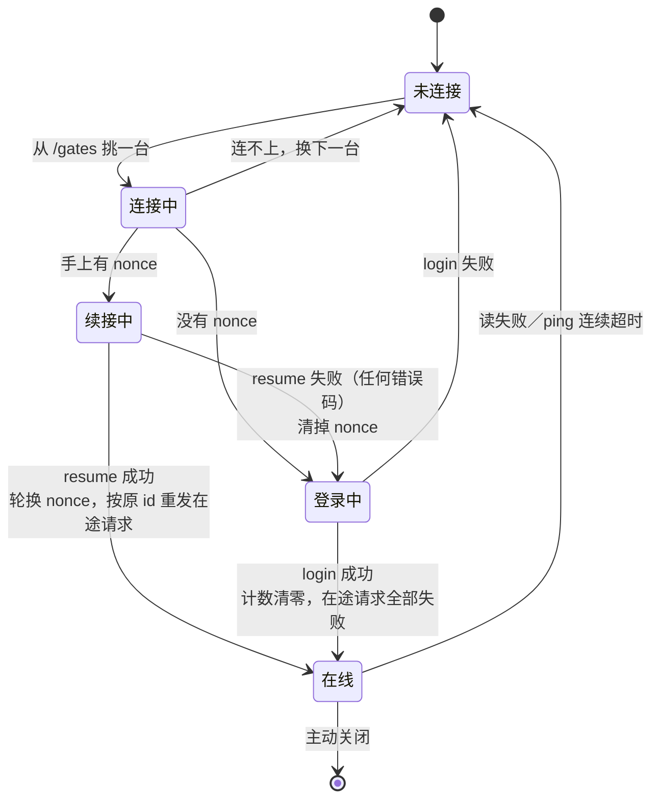
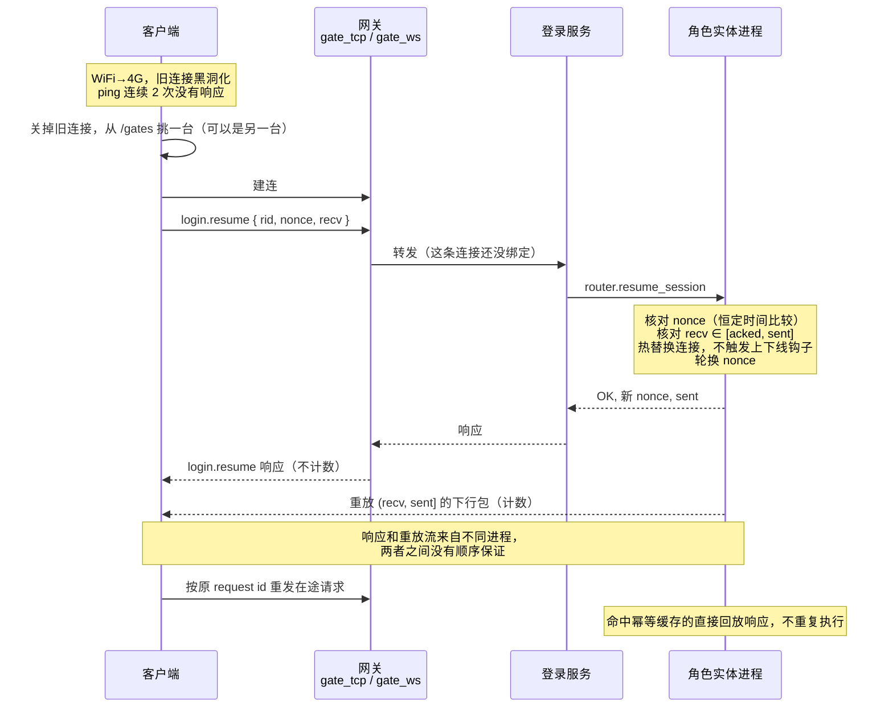

# 客户端接入规范

这份文档是写给**客户端 SDK 作者**的：按它实现，客户端就能连上 skyext、在断网后把会话接回来，而不丢请求、不重复扣费。

服务端的设计背景不在这里，在 `docs/design/session_resume.md`。可执行的参考实现是 `example/lualib/client_session.lua`（Lua，robot 在用），协议语义的回归测试是 `example/lualib/client_session.test.lua`。**新平台的 SDK 请照这份文档实现，不要逐行翻译参考实现**——参考实现里混了 skynet 协程的细节，那些是 Lua 侧的事。

## 1. 传输

两种接入，业务行为必须完全一致。选哪种只取决于平台能力：

| 传输 | 适用 | 分帧 |
| --- | --- | --- |
| 裸 TCP | 原生 APP | **2 字节大端长度前缀** + 包体 |
| WebSocket | 浏览器、小程序 | WS **binary** 帧，**不加长度前缀**，帧边界就是包边界 |

服务端对应 `service/gate_tcp.lua` 和 `service/gate_ws.lua`，是两个端口、两个服务。`wss` 由同一个 WS 网关提供。

两种传输都保证**单条连接内有序、不丢**，下面的隐式计数完全建立在这个前提上。

### 怎么知道连哪里

请求 Account 的 `GET /gates`（不需要登录）：

```json
{ "code": 0, "gates": [
  { "node": "gate1", "tcp_addr": "10.0.0.1:7012", "ws_url": "wss://gw.example.com", "weight": 1 }
] }
```

列表里只会有**真的在线**的网关（网关键挂在节点租约上，进程没了就消失；节点开始停服时会主动摘掉自己）。客户端自己从列表里挑一台，连不上就换下一台。

**不要把地址写死**，也不要指望服务端替你挑：挑选和重试是客户端的能力，服务端代劳之后客户端就没法换一台重连了——而这恰恰是断线续接最需要的。连哪一台都能进游戏，网关只管连接，上行包由它转发到角色实体真正所在的节点。

## 2. 包格式

sproto。`example/proto/base.sproto` 定义了包头：

```sproto
.package {
    type 0 : integer
    session 1 : integer
}
```

`session` 就是本文说的 **request id**：由客户端生成、逐个自增，响应原样带回。它同时是服务端的**幂等键**，下面第 3 节会用到。

## 3. 客户端的五条义务

一条都不能省。省掉任何一条，症状都是「平时好好的，断网之后数据错乱」，而且**不报错**。

### 义务一：请求带自增 request id，续接后用原 id 重发

每个请求一个新的 request id。连接断了、会话续接成功之后，**所有还没收到响应的请求必须按原来的 id 重发**。

服务端对已经执行过的 request id 回放缓存的响应，不会执行第二遍。换一个新 id 重发，服务端认不出来，扣费和抽卡就会执行两次。

缓存容量由 `session_respcache_count` / `session_respcache_bytes` 限制（默认 64 条 / 16 KiB），覆盖一次断线窗口里的在途请求绰绰有余。

重发之后可能收到**两份响应**（另一份是重放过来的）。认领先到的那份，后到的丢掉——但要先计数，见义务二。

**计数器只增不减，续接前后必须连续。** 这是最容易写错、后果也最重的一条：重连逻辑里顺手把计数器清零，看起来人畜无害，实际上**续接不重建服务端会话**，幂等缓存还是断线前那张。重置后的小 id 会直接命中缓存里**另一个请求**的响应，客户端把它当成这次请求的结果——没有报错，数据就是错的。

服务端有一道网：缓存项记了协议名，命中时核对，对不上回 `REQUEST_CONFLICT`（26）。但它只能在协议名不同的时候发现问题，重置后第一个请求恰好撞上同名的旧请求时拦不住。**别依赖它，它是用来让你在测试期就看见这个 bug 的。**

完整登录（`login.login`）会在服务端重建会话、清空缓存，那时重置与否都正确。既然如此，一直自增最省事。request id 是 64 位整数，不存在溢出。

### 义务二：数收到的下行包

序号**不在包里传**。TCP/WS 在一条连接内有序不丢，所以两端各数各的，只在 `resume` 和 `ping` 的时候对账一次。这省掉了每个包上的几个字节和一次写入。

代价是**会失同步**：漏数一个或多数一个，重放就错位。所以计数的位置要固定——**收到就数，在解码分发之前数**。这样协议热更导致的解码失败也不会让计数跑偏。

数的是**收到的包**，不是**认得的包**。最容易踩的是这一条：续接之后，同一个请求的响应会到达两次——一份是重放出来的（服务端在断线前就发过了），一份是你按义务一用原 id 重发后命中幂等缓存的。你只会认领其中一份，另一份匹配不上任何在途请求。**它照样要计数**，服务端那边两份都计了。很多 SDK 会在这里写一句「收到了没人要的响应」然后直接 return，计数就从此永久少一。

丢掉的那一份一定是计数内的：握手类请求的响应从不进重放缓冲，不可能被重放。

### 义务三：握手回包不计数

这三个响应处在计数边界之外，收到时**不要加一**：

- `login.login` 的响应
- `login.resume` 的响应
- `login.ping` 的响应

服务端那一侧的同款名单在 `lualib/skyext/entity/session.lua` 的 `UNCOUNTED_RESPONSE`，两边必须一致。

为什么是这三个：`resume` 的响应如果计数，客户端会在收到重放的旧包之前先把计数加一，下一次自校验立刻失配；`ping` 的响应如果计数，「已发出多少包」就得回答「包括我自己吗」，是现成的差一错误；`login` 发生在会话还不存在的时候。

注意是按**请求名**判断，不是按包的方向——服务端主动推的包（push）照常计数。

### 义务四：自己发现断线

手机从 WiFi 切到 4G 时，旧连接**不产生 FIN 也不产生 RST**，它直接变成黑洞：写进去不报错，永远收不到回包。操作系统不会告诉你，`onclose` 不会触发。

所以客户端必须定期发 `login.ping` 并**等它的响应**。参考实现是 15 秒一次、连续 2 次没等到响应就判定连接已死、主动关闭并重连。单向心跳没有用——那只让服务端知道客户端活着，客户端自己仍然一无所知。

服务端也有一侧的空闲断开：`session_idle_timeout`（默认 60 秒）内没有任何上行包就断开连接。心跳间隔必须明显小于它。

### 义务五：接受 resume 响应和重放流不保序

续接成功后，服务端会把客户端还没收到的下行包重放过来。**`login.resume` 的响应和这些重放包之间没有任何顺序保证**：响应来自登录服务，重放来自角色实体所在的进程，跨节点时它们走的是两条不同的 TCP 连接。

这不要紧，但前提是你没有做出相反的假设：

- 不要「等 resume 响应到达之后再开始处理下行包」
- 不要用「收到 resume 响应」作为重放结束的标志（没有这个标志，也不需要）
- resume 的响应靠 request id 认领，又不计数，早到晚到都不影响正确性

服务端**只保证重放流内部**旧包在前、新包在后。

## 4. 协议

三条协议都在 `example/proto/login.sproto`。

### login.login（100）

```sproto
request  { token, rid, proto_checksum, server }
response { code, rid, nonce }
```

`token` 是 JWT（签发方式见[登录流程](login.md)），`rid` / `server` 是客户端自报的角色和出生服——服务端会查库确认这个角色确实属于 token 里的账号、且在那个服。

成功后拿到 **`nonce`：16 字节续接凭据**。它只代表一条会话，权限比代表整个账号的 token 小得多，最长活到角色实体卸载。

登录成功即**会话开始**：下行计数从 0 起算。登录阶段（绑定成功之前）的包两边都不计。

### login.resume（101）

```sproto
request  { rid, nonce, recv }
response { code, nonce, sent }
```

断线重连后**先试这个**，失败了再走完整登录。它不验 token、不查库，**也不会把实体从数据库里加载起来**——只能续上还在内存里的会话。

- `rid` 只用于路由
- `nonce` 是上一次 `login` 或 `resume` 返回的那一枚。**每次成功都轮换**，用过的立即失效；响应里的新 `nonce` 要存下来给下一次用
- `recv` 是客户端数到的下行包数。服务端核它必须落在 `[已确认, 已发出]` 区间内，对不上就拒绝续接
- 响应的 `sent` 是服务端已发出的包数，`(recv, sent]` 这些包正在重放过来。客户端可以用它反向自检，但**不要等**

**任何错误码都按同一种方式处理：清掉 nonce，走完整登录。** 不要重试 resume，不要按错误码分支——区分「凭据错」和「实体已卸载」对客户端没有意义，而且服务端有意不告诉你更多。

续接窗口等于角色实体的 `unload_delay`：没有单独的计时器，实体一卸载会话就没了。

### login.ping（102）

```sproto
request  { recv }
response { sent }
```

心跳兼对账。`recv` 顺便让服务端确认客户端已经收到的包，让它释放重放缓冲——所以心跳不只是保活，不发会让服务端的缓冲一直涨到上限（`session_replay_bytes` / `session_replay_packets`，默认 32 KiB / 256 包），撑爆之后会话就不可续接了。

客户端应当校验 `sent` 等于自己的计数，不等就说明已经失同步：清掉 nonce、断开、走完整登录。这个检查很便宜，因为它只在心跳这条低频路径上。

## 5. 状态机



两个容易写错的地方：

- **续接成功后在途请求要重发；完整登录成功后在途请求要全部失败掉。** 后者的会话在服务端已经不存在了，响应永远不会来，必须让上层的调用方拿到失败而不是一直挂着。
- **`login` / `resume` / `ping` 自己的在途请求不参与重发**：旧连接上的那一次永远不会有响应，直接失败掉。

## 6. 续接时序



业务层**观察不到**这次断线：续接走的是连接热替换，不触发 `on_bind_client` / `on_unbind_client`，角色实体一直在线。

## 7. 一份自检清单

写完 SDK 后逐条过一遍，这些是实现里真实踩过的坑：

- [ ] 断线重连后，在途请求用的是**原来的** request id
- [ ] request id 计数器在续接前后**连续**，重连路径上没有任何地方把它清零
- [ ] `login` / `resume` / `ping` 的响应**没有**计入下行计数，push **计入**了
- [ ] 计数发生在解码分发**之前**
- [ ] 匹配不上任何在途请求的响应（续接后的重复回包）**计数了**才丢弃，而不是直接 return
- [ ] 续接成功后保存了**新的** nonce，旧的没有再被用过
- [ ] resume 失败时走的是完整登录，而不是重试 resume
- [ ] 完整登录之后下行计数**清零**了
- [ ] 代码里没有任何地方假设 resume 响应先于重放包到达
- [ ] 收包线程/协程在连接被别处关闭时**不会死掉**（参考实现在这里栽过：`websocket.read` 在连接关闭时是抛异常而不是返回空，收包协程一死整个会话就哑了，续接和重登都只能等到超时）
- [ ] ping 超时判定基于**收到响应**，不是基于发送成功
- [ ] 两种传输跑同一套用例，行为完全一致（robot 就是这么验的，见 `robot_transports`）
