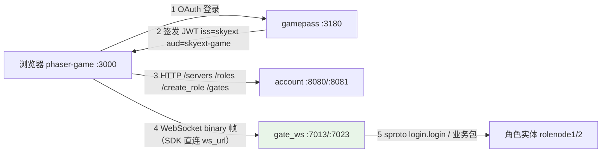

# 完整客户端联调（gamepass + phaser-game）

机器人（`./bin/skyext serve robot`）走的是开发链路：`/dev_login` 签 token，再按 `GET /gates` 拿到的地址直连网关。本文讲的是**正式客户端链路**：浏览器里的 Phaser 客户端进游戏，登录凭据由 OAuth 鉴权服务签发。两个配套仓库都是 git submodule，位于 `example/tools/` 下：

| 子模块 | 作用 | 技术栈 | 端口 |
|--------|------|--------|------|
| [gamepass](https://github.com/hanxi/gamepass) | OAuth2 鉴权服务，签发登录 JWT | Go + Gin + MongoDB | 3180 |
| [phaser-game](https://github.com/hanxi/phaser-game) | 示例浏览器客户端 | TypeScript + Phaser 3 + Bun | 静态页 3000 |

> **goscon 去哪了？** 早期 phaser-game 用 `sconn-client`（goscon 的 SCP 协议库）接入，需要 goscon 做 WebSocket → TCP 代理。迁移到官方 [客户端 SDK](client_sdk.md)（`skyext-client`）之后，客户端直连 `gate_ws` 的 `ws_url`，断线续接由会话层原生完成（凭据轮换 + 服务端幂等重放，比 SCP 的字节级续接更强——请求不会被执行两次），goscon 已从示例链路退役。它仍是 submodule（`example/tools/goscon`），只有真的需要字节级连接续接的场景才用，见根 README 的说明。



## 前置条件

- 已按[快速上手](../getting-started.md)完成构建，MongoDB 与 etcd 已启动（`example/tools/{mongodb,etcd}` 的 Compose 配置）。
- 初始化子模块：`git submodule update --init example/tools/gamepass example/tools/phaser-game`（或根目录 `make init` 全量初始化）。
- Go 1.23+、[Bun](https://bun.sh/)。
- 端口占用一览：27017（MongoDB）、2377/2378/2379（etcd）、8080/8081（account HTTP）、7012/7022（gate TCP，本链路用不到）、7013/7023（gate WS）、3180（gamepass）、3000（客户端静态页）。

## 1. 启动 skyext 节点

仓库根目录，各开一个终端（或后台运行）：

```bash
./bin/skyext serve account1   # HTTP 8080
./bin/skyext serve account2   # HTTP 8081（serverlist.json 里两个 account 都列了，只起一个也行，见下）
./bin/skyext serve role1      # gate TCP 7012 / WS 7013
./bin/skyext serve role2      # gate TCP 7022 / WS 7023
```

`phaser-game/public/serverlist.json` 只剩一个字段 `account_hosts`：SDK 随机挑一个发请求、传输失败自动换下一台，只想起单 account 的话把 8081 从列表里去掉即可（该文件在 phaser-game 仓库内，属于客户端侧配置）。服务器列表和网关地址都不在客户端配置里——分别来自 `GET /servers` 和 `GET /gates`。

## 2. 启动 gamepass

```bash
cd example/tools/gamepass
cp .env.example .env
go build -o gamepass .
./gamepass        # 监听 :3180，用户数据存本机 MongoDB 的 gamepass 库
```

`.env` 里必须和 skyext 对齐的配置（`example/etc/nodes/common.app.lua`）：

| gamepass `.env` | skyext 配置 | 示例值 | 说明 |
|-----------------|------------|--------|------|
| `JWT_ACCESS_SECRET` | `login_jwt_secret` | `your_access_secret` | HS256 签名密钥，两边必须一致 |
| `JWT_ISSUER` | `login_jwt_issuer` | `skyext` | 不配置则 JWT 不带 `iss`，skyext 会拒绝 |
| `JWT_AUDIENCE` | `login_jwt_audience` | `skyext-game` | 同上，对应 `aud` |
| `CALLBACK_WHITELIST` | — | `^http://localhost:[0-9]+/.*$` | 回调地址白名单（正则），必须能匹配客户端页面地址 |

本地联调用**本地账号**（local provider）即可，不需要 GitHub OAuth：

- `OPENID_CONNECT_KEY` 留空——否则 gamepass 启动时会去连 `OPENID_CONNECT_DISCOVERY_URL`（默认 3181），连不上直接退出。本地账号密码登录走 gamepass 自己的 `/login` 页面，不经过 OIDC。
- `GITHUB_KEY`/`GITHUB_SECRET` 保持占位即可，"Login with GitHub" 按钮不可用但不影响其余流程；要试 GitHub 登录需填真实的 OAuth App 凭据。

首次使用先到 `http://localhost:3180/register` 注册一个本地账号（或让客户端登录页跳转后注册）。

JWT 的 `account` 字段是 gamepass 用户的 MongoDB ObjectId；skyext 侧只把它当作不透明账号名使用，Account 服务据此建用户文档、管角色归属。

## 3. 构建并启动 phaser-game

```bash
cd example/tools/phaser-game
bun install
# 同步协议文件（见下方说明，proto 变更后必须重做）
cp ../../build/proto/sproto.spb public/resources/protocol/sproto.spb
bun run build
bun run serve        # 或任意静态服务器，如 python3 -m http.server 3000 -d dist
```

SDK 依赖是 `file:../../../sdk/ts`（skyext 仓库内的 `sdk/ts`），`bun install` 会把它链接进 `node_modules/skyext-client`，所以 phaser-game 必须在 skyext 检出内构建。

**协议文件必须与服务端一致**：客户端登录时 SDK 自动带上 `sproto.spb` 的 checksum，服务端 `proto_checksum_enable = true` 时会校验，不一致返回 `code = 103`（PROTO_CHECKSUM）。凡是跑过 `make -C example proto`（协议有变更），都要重新执行上面的 `cp` 并重新 build。

浏览器打开 `http://localhost:3000`：

1. 点 **Login with Local** → 跳到 gamepass 登录页（首次先注册）；
2. 登录成功自动带 token 跳回游戏页；
3. 选服（`/servers` 拉取，未开放的服置灰）→ 建角或选择已有角色（`/roles`、`/create_role`）；
4. SDK 经 `/gates` 拿到在线网关的 `ws_url`，WebSocket 直连（连不上自动换下一台），`login.login` 完成登录，进入游戏场景；
5. 之后断网/切网都不用管：会话层自动续接（凭据轮换、在途请求按原 id 重发）——业务无感，不会重新登录。验证断线续接时注意：**Chrome 的 offline 模拟（含 DevTools Network 面板的 Offline）不会断开已建立的 WebSocket**（实测 Chrome 150，DevTools 与 CDP `Network.emulateNetworkConditions` 同机制），用它「断网」看不出任何现象；要用操作系统级断网/切网（拔网线、关 Wi-Fi），或跑自动化脚本 `example/tools/browser_e2e.mjs`（`npm i playwright-core` 后 `node browser_e2e.mjs [服序号]`，需全链已起）。脚本用两种方式切线并断言续接：实例级 `close()`（对应 close 事件驱动的重连）与 `send` 黑洞（无 close 事件，逼心跳 15s×2 超时自检，即规范义务 4）；两条路径都验证「offline → online 状态序列中无 relogin、在途请求按原 id 完成、nonce 轮换」。控制台里对未启动的 account host（如只起 account1 时 8081 的 `ERR_CONNECTION_REFUSED`）是 SDK 按设计在轮换下一台，不是故障。

客户端在浏览器侧跑，`serverlist.json` 里的 `localhost`/`127.0.0.1` 指的是**浏览器所在机器**；`ws_url` 则是**服务端注册进 realm 的地址**（`gate_public_host` / `ws_public_url`，默认取 `cluster_host`）。服务端在远程开发机时，要么做端口转发（3000/3180/8080/8081/7013/7023），要么把 `gate_public_host`/account 地址配成浏览器可达的实际地址后重启节点、重新 build。

## 无浏览器验证（headless E2E）

不开浏览器也能验证整条链路：SDK 是纯 TS 库，Bun 里可直接跑。以下脚本依次走 gamepass 登录 → `/servers` → `/roles` → `/gates` 直连 → `login.login` → `role.login_info`：

```ts
// e2e_login.ts —— 在 example/tools/phaser-game 目录下: bun e2e_login.ts
import { readFileSync } from "fs";
import { SkyextClient } from "skyext-client";

const spb = new Uint8Array(readFileSync("../../build/proto/sproto.spb"));

const tokens: any = await (await fetch("http://localhost:3180/auth/local/login", {
  method: "POST",
  headers: { "Content-Type": "application/json" },
  body: JSON.stringify({ email: "e2e@test.local", password: "pass1234" }),
})).json();

const client = new SkyextClient({
  accountHosts: ["http://127.0.0.1:8080"],
  spb,
  tokenProvider: () => tokens.access_token, // 每次完整登录调用；续接不调用
});

const server = await client.account.pickRecommendedServer();
let role = (await client.account.roles(tokens.access_token, server!))?.[0] ?? null;
role ??= await client.account.createRole(tokens.access_token, server!, "e2e");

if (!(await client.enterGame({ rid: role!.rid, server: role!.server }))) {
  throw new Error("enterGame failed");
}
console.log(await client.request("role.login_info"));
client.close();
```

`role.login_info` 返回 `{"code":0,"info":{...}}` 即全链路通过。没有 gamepass 时把 token 来源换成 `client.account.devLogin("e2e")`（仅开发环境开放）。

> 断线续接的验证不需要浏览器：机器人（`./bin/skyext serve robot`）在 tcp 和 ws 两种传输上各跑一遍断线续接用例；SDK 自己的全链路测试在 `sdk/ts`（`SKYEXT_E2E=1 bun test test/e2e`），含「在途请求跨重连按原 id 完成」。

## rid 与 JS 安全整数

rid 是 snowflake ID（`lualib/skyext/snowflake.lua`）。SDK 对超过 2^53 的整数全程用 `bigint`（JSON 侧 `parseJson`、sproto 侧 int64 补丁，见[客户端 SDK](client_sdk.md) 的 int64 约定），**rid 无损往返，浏览器客户端不再受 `Number.MAX_SAFE_INTEGER` 限制**。业务代码注意一条：拿到 `RoleInfo.rid` 后原样传回（`enterGame`、协议参数都接受 `bigint | number`），不要 `Number()` 它。

历史背景：迁移前的 phaser-game 用 double 传 rid，为此雪花位宽被压到 `MACHINE_BIT + SEQUENCE_BIT <= 21`（最大 rid = 2^53-1，代码里有 assert）。这个 assert 保留不动——放宽位宽是服务端决策，与客户端无关。位宽调整（2026-10）之前生成的超大 rid 旧角色，现在 SDK 客户端也能直接登录，不再需要删库重建。

## 常见问题

| 现象 | 原因与处理 |
|------|-----------|
| 登录返回 `code=22`（internal error），role 节点日志有 `dest address type (nil)` | 节点冷启动后立刻登录，服务发现/cluster sender 还没就绪的竞态。等几秒重试即可；持续出现才需要排查 etcd |
| 登录返回 `code=100`（ROLE_NOT_EXIST） | 角色不属于该账号，或 `login.login` 报的 server 不是角色的出生服 |
| 登录返回 `code=103`（PROTO_CHECKSUM） | `sproto.spb` 没同步，重做第 3 步的 `cp` + build |
| 登录返回 `code=24`（RESUME_UNAVAILABLE） | 续接不了（重放缓冲溢出/计数越界），SDK 会自动清凭据走完整登录，无需处理；频繁出现才需要查服务端会话配置 |
| gamepass 启动即退出，日志有 `dial tcp 127.0.0.1:3181 ... refused` | `OPENID_CONNECT_KEY` 没留空，启动时在连 OIDC discovery 地址 |
| gamepass 返回 `Provided callback_url is not allowed` | `CALLBACK_WHITELIST` 正则没匹配上客户端页面地址（默认回调是 `http://localhost:3000/`） |
| skyext 侧日志 `invalid issuer` / `invalid audience` | gamepass 的 `JWT_ISSUER`/`JWT_AUDIENCE` 与 `login_jwt_issuer`/`login_jwt_audience` 不一致（或没配） |
| 客户端连 `ws_url` 收到乱码或直接断开 | 连错端口了：`ws_port` 上是裸 WebSocket 二进制帧，`gate_port` 上是 2 字节大端长度前缀的 TCP 流，两者不能混 |
| `/gates` 返回空 | 没有在线的游戏节点（网关键挂在节点租约上），先起 role1/role2 |

## 停止

示例默认没配 `gm_auth_token`（GM 接口关闭），本地联调直接 kill skyext 进程即可——代价是丢掉最近一次回存（`db_save_interval`，默认 3 分钟）之后的改动，实体锁等 30 秒租约过期自动清。正式停服流程（落库、释放锁、踢下线）见[快速上手](../getting-started.md)的 GM `shutdown` 一节，需要先配置 GM token。gamepass / 静态服务器 Ctrl+C 即可，无状态（gamepass 数据在 MongoDB）。网关节点一旦退出，它在 realm 里的接入地址键会随节点租约消失，`GET /gates` 不会再把客户端引导过来。
