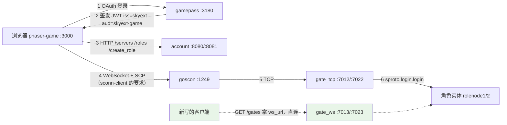

# 完整客户端联调（gamepass + goscon + phaser-game）

机器人（`./bin/skyext serve robot`）走的是开发链路：`/dev_login` 签 token，再按 `GET /gates` 拿到的地址直连网关。本文讲的是**正式客户端链路**：浏览器里的 Phaser 客户端进游戏，登录凭据由 OAuth 鉴权服务签发。三个配套仓库都是 git submodule，位于 `example/tools/` 下：

| 子模块 | 作用 | 技术栈 | 端口 |
|--------|------|--------|------|
| [gamepass](https://github.com/hanxi/gamepass) | OAuth2 鉴权服务，签发登录 JWT | Go + Gin + MongoDB | 3180 |
| [goscon](https://github.com/hanxi/goscon) | WebSocket → TCP 网关（SCP 协议） | Go | WS 1249，管理 6620 |
| [phaser-game](https://github.com/hanxi/phaser-game) | 示例浏览器客户端 | TypeScript + Phaser 3 + Bun | 静态页 3000 |

> **这里为什么还有 goscon？** skyext 自己的 WebSocket 接入由 `service/gate_ws.lua` 原生承载，断线续接也在会话层原生实现了（见[客户端接入规范](client_protocol.md)），服务端不需要 goscon。但 phaser-game 这个示例客户端用的是 `sconn-client`——goscon 的 SCP 协议库——它说的不是 skyext 的裸 WebSocket 协议，所以**跑这个示例客户端仍然要起 goscon**。这是示例客户端的属性，不是 skyext 的。新写的客户端直接连 `gate_ws` 的 `ws_url` 就行，不要再引入这一跳。



## 前置条件

- 已按[快速上手](../getting-started.md)完成构建，MongoDB 与 etcd 已启动（`example/tools/{mongodb,etcd}` 的 Compose 配置）。
- 初始化子模块：`git submodule update --init example/tools/gamepass example/tools/goscon example/tools/phaser-game`（或根目录 `make init` 全量初始化）。
- Go 1.23+、[Bun](https://bun.sh/)。
- 端口占用一览：27017（MongoDB）、2377/2378/2379（etcd）、8080/8081（account HTTP）、7012/7022（gate TCP）、7013/7023（gate WS）、3180（gamepass）、1249（goscon WS）、3000（客户端静态页）。

## 1. 启动 skyext 节点

仓库根目录，各开一个终端（或后台运行）：

```bash
./bin/skyext serve account1   # HTTP 8080
./bin/skyext serve account2   # HTTP 8081（serverlist.json 里两个 account 都列了，只起一个也行，见下）
./bin/skyext serve role1      # gate TCP 7012 / WS 7013
./bin/skyext serve role2      # gate TCP 7022 / WS 7023
```

`phaser-game/public/serverlist.json` 里的 `account_hosts` 随机挑一个发请求，只想起单 account 的话把 8081 从列表里去掉即可（该文件在 phaser-game 仓库内，属于客户端侧配置）。

## 2. 启动 gamepass

```bash
cd example/tools/gamepass
cp .env.example .env
go build -o gamepass .
./gamepass        # 监听 :3180，用户数据存本机 MongoDB 的 gamepass 库
```

`.env` 里必须和 skyext 对齐的配置（`example/etc/nodes/common.app.lua`）：

| gamepass `.env` | skyext 配置 | 示例值 | 说明 |
|-----------------|------------|--------|------|
| `JWT_ACCESS_SECRET` | `login_jwt_secret` | `your_access_secret` | HS256 签名密钥，两边必须一致 |
| `JWT_ISSUER` | `login_jwt_issuer` | `skyext` | 不配置则 JWT 不带 `iss`，skyext 会拒绝 |
| `JWT_AUDIENCE` | `login_jwt_audience` | `skyext-game` | 同上，对应 `aud` |
| `CALLBACK_WHITELIST` | — | `^http://localhost:[0-9]+/.*$` | 回调地址白名单（正则），必须能匹配客户端页面地址 |

本地联调用**本地账号**（local provider）即可，不需要 GitHub OAuth：

- `OPENID_CONNECT_KEY` 留空——否则 gamepass 启动时会去连 `OPENID_CONNECT_DISCOVERY_URL`（默认 3181），连不上直接退出。本地账号密码登录走 gamepass 自己的 `/login` 页面，不经过 OIDC。
- `GITHUB_KEY`/`GITHUB_SECRET` 保持占位即可，"Login with GitHub" 按钮不可用但不影响其余流程；要试 GitHub 登录需填真实的 OAuth App 凭据。

首次使用先到 `http://localhost:3180/register` 注册一个本地账号（或让客户端登录页跳转后注册）。

JWT 的 `account` 字段是 gamepass 用户的 MongoDB ObjectId；skyext 侧只把它当作不透明账号名使用，Account 服务据此建用户文档、管角色归属。

## 3. 启动 goscon（只为 phaser-game 而起）

再说一次：只有 `sconn-client` 需要它。自己写客户端的话跳过这一节，第 4 步也不用管 goscon 的地址。

```bash
cd example/tools/goscon
go build -o goscon .
./goscon -logtostderr -v 3 -config config.yaml
```

仓库里的 `config.yaml` 已按示例拓扑配好：WS 监听 `0.0.0.0:1249`，上游两个 gate 的 **TCP** 口（`role1 → 127.0.0.1:7012`、`role2 → 127.0.0.1:7022`，按权重轮选）。gate 端口如有改动，同步改 `hosts` 段。

**不要打开 goscon 的 `-sproto` 开关**：那个开关会往游戏服注入 `login.report_remote_addr`，该协议已经删除。真要在代理后面拿客户端真实 IP，用 PROXY protocol，而不是带内消息。

## 4. 构建并启动 phaser-game

```bash
cd example/tools/phaser-game
bun install
# 同步协议文件（见下方说明，proto 变更后必须重做）
cp ../../build/proto/sproto.spb public/resources/protocol/sproto.spb
bun run build
bun run serve        # 或任意静态服务器，如 python3 -m http.server 3000 -d dist
```

**协议文件必须与服务端一致**：客户端登录时会带上 `sproto.spb` 的 checksum，服务端 `proto_checksum_enable = true` 时会校验，不一致返回 `code = 103`（PROTO_CHECKSUM）。凡是跑过 `make -C example proto`（协议有变更），都要重新执行上面的 `cp` 并重新 build。

浏览器打开 `http://localhost:3000`：

1. 点 **Login with Local** → 跳到 gamepass 登录页（首次先注册）；
2. 登录成功自动带 token 跳回游戏页；
3. 选服（`/servers` 拉取）→ 建角或选择已有角色（`/roles`、`/create_role`）；
4. 客户端经 goscon 连上 gate，发 `login.login` 完成登录，进入游戏场景。

客户端在浏览器侧跑，`serverlist.json` 里的 `localhost`/`127.0.0.1` 指的是**浏览器所在机器**。服务端在远程开发机时，要么做端口转发（3000/3180/1249/8080/8081），要么改成实际地址后重新 build。

## 无浏览器验证（headless E2E）

不开浏览器也能验证整条链路：phaser-game 用的 `sconn-client` 是纯 TS 库，Bun 里可直接跑。以下脚本依次走 gamepass 登录 → `/roles` → goscon WS → `login.login` → `role.login_info`（这条路径连的是 goscon 的固定地址，不经过 `/gates`）：

```ts
// e2e_login.ts —— 在 example/tools/phaser-game 目录下: bun e2e_login.ts
import { Network } from "sconn-client";
import { readFileSync } from "fs";

const spb = new Uint8Array(readFileSync("../../build/proto/sproto.spb"));
const net = new Network(spb);

const tokens: any = await (await fetch("http://localhost:3180/auth/local/login", {
  method: "POST",
  headers: { "Content-Type": "application/json" },
  body: JSON.stringify({ email: "e2e@test.local", password: "pass1234" }),
})).json();

const roles: any = await (await fetch("http://127.0.0.1:8080/roles", {
  headers: { Authorization: `Bearer ${tokens.access_token}` },
})).json();
const role = roles.roles[0]; // 没有角色时先 POST /create_role

const c = net.connect("ws://localhost:1249", "rolenode1");
if (!c.success) throw new Error(JSON.stringify(c));
const timer = setInterval(() => net.update(), 16);
while (!net.isConnected()) await new Promise((r) => setTimeout(r, 50));

console.log(await net.call("login.login", {
  token: tokens.access_token, rid: role.rid, server: role.server,
  proto_checksum: net.checksumValue(),
}));
console.log(await net.call("role.login_info"));
clearInterval(timer);
```

`login.login` 返回 `{"code":0, "rid":..., "nonce":"..."}`、`role.login_info` 返回角色信息即全链路通过。

> 这个脚本用的是 SCP 的字节级重连，不走 skyext 的 `login.resume`。要验证会话续接，用机器人：`./bin/skyext serve robot` 的测试集里有断线续接用例，tcp 和 ws 两种传输都会跑一遍。

## rid 与 JS 安全整数

rid 是 snowflake ID（`lualib/skyext/snowflake.lua`），位宽 **32 位秒级时间戳 + 8 位机器号 + 13 位序列号**。低 21 位的总量是硬约束：最大 rid = 2^53-1，恰好是 JS 的 `Number.MAX_SAFE_INTEGER`。浏览器客户端从 `JSON.parse` 到 sproto 编码全程用 double 传 rid，一旦超过 2^53 就会精度丢失（尾数被舍入），登录时上报的 rid 与库里对不上，返回 `ROLE_NOT_EXIST`。**调整雪花位宽前必须保证 `MACHINE_BIT + SEQUENCE_BIT <= 21`**（代码里有 assert 拦截）。

历史数据注意：位宽调整（2026-10）之前生成的 rid 都大于 2^53，这些旧角色机器人（Lua 侧 64 位整数无损）仍能登录，但浏览器客户端登不了，本地开发库建议直接删掉重建：

```bash
docker exec local-mongo mongosh --quiet --eval '
  db.getSiblingDB("role").role.deleteMany({});
  db.getSiblingDB("center").role_name.deleteMany({});'
```

## 常见问题

| 现象 | 原因与处理 |
|------|-----------|
| 登录返回 `code=22`（internal error），role 节点日志有 `dest address type (nil)` | 节点冷启动后立刻登录，服务发现/cluster sender 还没就绪的竞态。等几秒重试即可；持续出现才需要排查 etcd |
| 登录返回 `code=100`（ROLE_NOT_EXIST） | 多半是旧的大 rid（见上节），删旧角色重建；也可能是角色不属于该账号或不在所报区服 |
| 登录返回 `code=103`（PROTO_CHECKSUM） | `sproto.spb` 没同步，重做第 4 步的 `cp` + build |
| gamepass 启动即退出，日志有 `dial tcp 127.0.0.1:3181 ... refused` | `OPENID_CONNECT_KEY` 没留空，启动时在连 OIDC discovery 地址 |
| gamepass 返回 `Provided callback_url is not allowed` | `CALLBACK_WHITELIST` 正则没匹配上客户端页面地址（默认回调是 `http://localhost:3000/`） |
| skyext 侧日志 `invalid issuer` / `invalid audience` | gamepass 的 `JWT_ISSUER`/`JWT_AUDIENCE` 与 `login_jwt_issuer`/`login_jwt_audience` 不一致（或没配） |
| 客户端连不上 goscon | 确认 1249 在监听、`config.yaml` 的 `hosts` 指向的 gate **TCP** 端口和实际 `gate_port` 一致（不是 `ws_port`） |
| 自己写的客户端连 `ws_url` 收到乱码 | 连错端口了：`ws_port` 上是裸 WebSocket 二进制帧，`gate_port` 上是 2 字节大端长度前缀的 TCP 流，两者不能混 |

## 停止

示例默认没配 `gm_auth_token`（GM 接口关闭），本地联调直接 kill skyext 进程即可——代价是丢掉最近一次回存（`db_save_interval`，默认 3 分钟）之后的改动，实体锁等 30 秒租约过期自动清。正式停服流程（落库、释放锁、踢下线）见[快速上手](../getting-started.md)的 GM `shutdown` 一节，需要先配置 GM token。gamepass / goscon / 静态服务器 Ctrl+C 即可，无状态（gamepass 数据在 MongoDB）。网关节点一旦退出，它在 realm 里的接入地址键会随节点租约消失，`GET /gates` 不会再把客户端引导过来。
