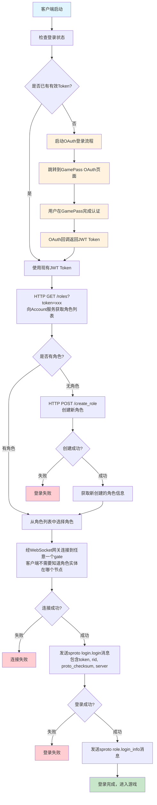
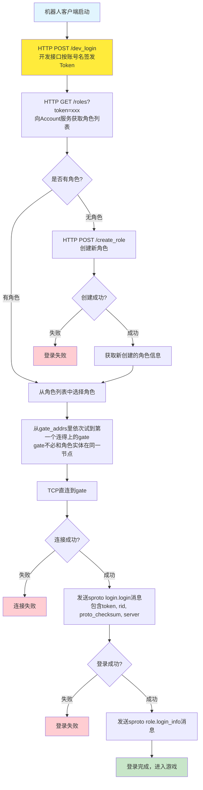
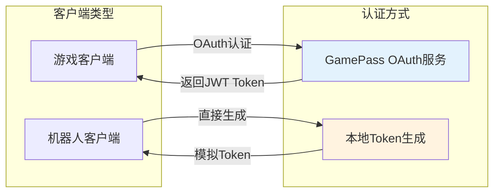
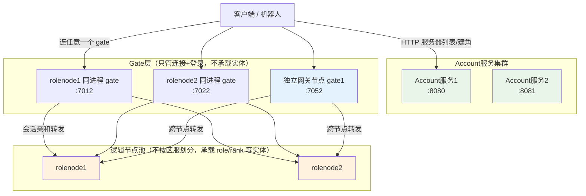
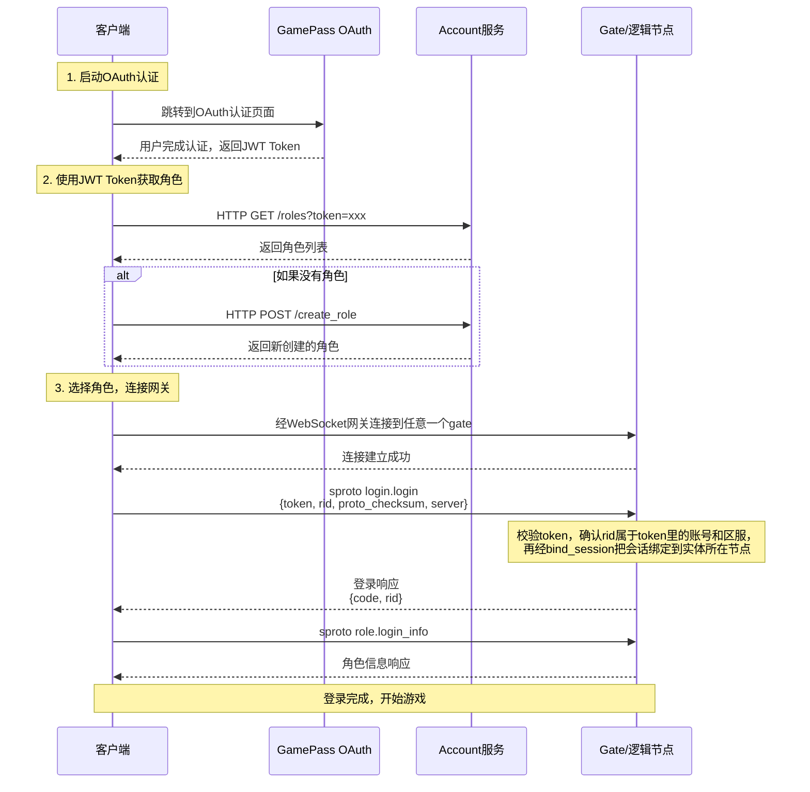
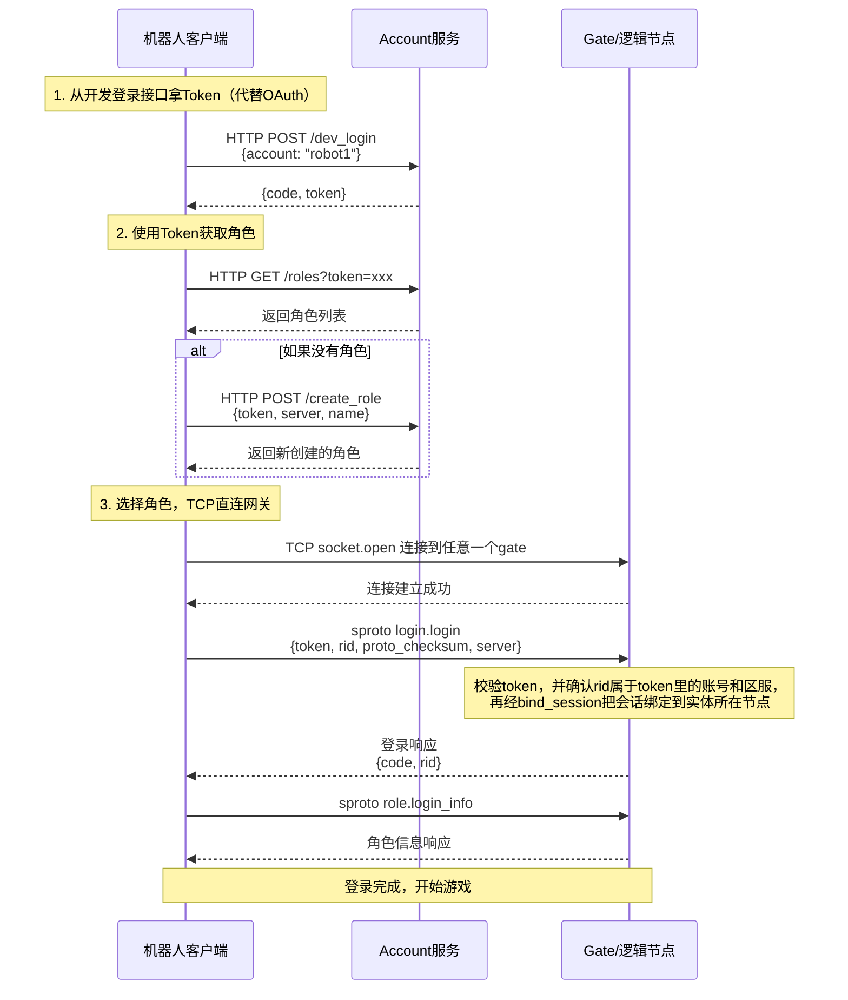

# 登录流程图

## 概述

系统支持两种认证方式：

1. **正式客户端 OAuth 认证**：通过 GamePass OAuth 服务进行用户身份认证，获取 JWT Token
2. **机器人客户端模拟认证**：机器人客户端直接生成 JWT Token，跳过 OAuth 流程

> **传输协议说明**：skynet gate 监听的是 TCP 端口。正式客户端通常经 WebSocket 网关（如 [goscon](https://github.com/hanxi/goscon)）转接到 TCP；机器人客户端使用 `socket.open` 直连 TCP。以下流程图中"连接到网关"均指最终到达 skynet gate 的连接。

## 完整登录流程（正式客户端）



## 机器人客户端简化流程



## 认证架构



## 服务集群架构



> 区服（server）→ 逻辑服（game）→ 战区（zone）是**逻辑概念**，存在 etcd 区服目录里，不对应物理节点；逻辑节点池承载所有区服的实体，开服/合服只改目录映射。见[架构概览](../overview.md)。

## 协议交互时序图

### 正式客户端 OAuth 认证流程



### 机器人客户端简化认证流程



## 关键数据结构

### JWT Token

**正式客户端**（通过 GamePass OAuth 获取）：

服务端 `jwt.verify_login`（`example/lualib/jwt.lua`）校验签名、`iss`、`aud` 和时效，业务代码仅使用 `account` 字段：

```json
{
  "account": "user_account_id",
  "iss": "skyext",
  "aud": "skyext-game",
  "iat": 1638360000,
  "exp": 1638360300
}
```

| 字段 | 说明 |
|------|------|
| iss / aud | 签发方与接收方，必须与 `login_jwt_issuer` / `login_jwt_audience` 一致。签名密钥只保证"是我们签的"，这两项保证"是这套服务签的、签给这套服务的"——同一密钥被别的系统或别的用途复用时不会互相串 |
| exp | **必填**，缺失直接拒绝：没有过期时间的登录 token 等于永久有效，一旦泄漏就收不回来。有效期由 `login_jwt_ttl` 决定 |
| iat / nbf | 可选。比较时都放宽 `login_jwt_leeway` 秒，容忍节点间时钟差 |

未知字段会被忽略。GamePass 这类外部签发方必须按上面的 `iss`/`aud` 签，否则服务端会拒绝。

**机器人客户端**（仅用于开发和测试）：向 Account 的 `POST /dev_login` 要 token，接口内部调用 `jwt.sign_login({ account = account })`。机器人自己不持有签名密钥。

`jwt.sign_login` 从配置取密钥和 `iss`/`aud`/`ttl`，自动补上 `iss`、`aud`、`iat`、`exp`。支持的签名算法：`HS256`、`HS512`。`/dev_login` 不校验身份，由 `dev_login_enable` 控制，正式环境必须关掉。

### Account 服务 API

**获取角色列表：**

```
GET /roles?token=jwt_token_string[&server=s1]

Response: { "code": 0, "roles": [{ "rid": 1, "server": "s1", "name": "..." }] }
```

> `server` 参数可选，传入时仅返回该区服的角色。服务端通过区服目录校验区服是否存在。

**服务器列表：**

```
GET /servers

Response: { "code": 0, "servers": [{ "server": "s1", "name": "一区", "tag": "S1", "status": "open", "open_time": 1700000000, "recommended": true }] }
```

**创建角色：**

```
POST /create_role
Body: { "token": "...", "server": "s1", "name": "角色名称" }

Response: { "code": 0, "role": { "rid": 1, "server": "s1", "name": "..." } }
```

> 只能在 `status = "open"` 的服建角；名字在出生服内唯一，重名返回 `NAME_TAKEN`。`max_role_count`（示例为 5）是单个区服的角色上限。
