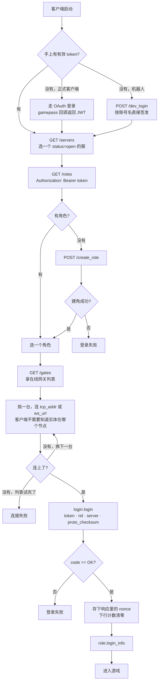
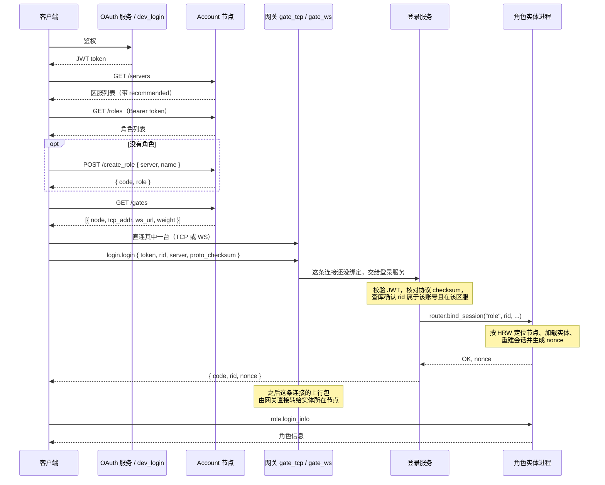
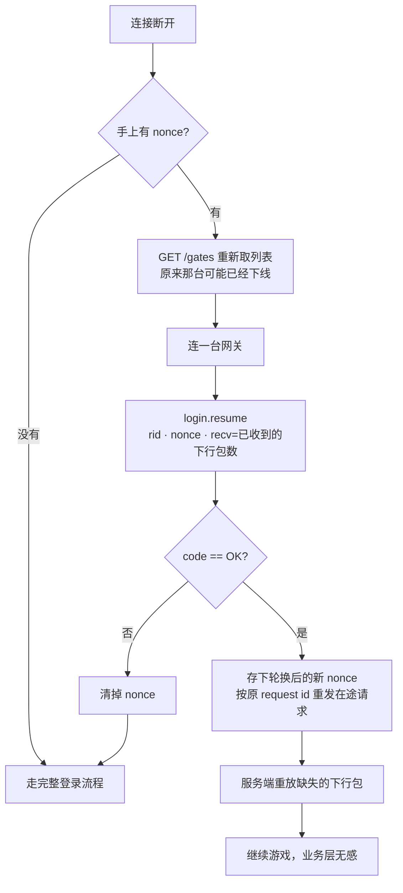

# 登录流程图

本文是[登录流程](login.md)的图示版，只画链路。配置项、错误码、HTTP 接口以那篇为准；客户端要实现哪些义务见[客户端接入规范](client_protocol.md)。集群拓扑和端口分布见[架构概览](../overview.md)的「示例部署」图。

两种登录方式的差别只在"token 从哪来"，拿到 token 之后的链路完全一样：

- **正式客户端**：走外部 OAuth 服务（示例用 gamepass）拿 JWT Token
- **机器人 / 开发客户端**：向 Account 的 `POST /dev_login` 要 token，正式环境必须关掉这个接口

网关节点同时监听 TCP 和 WebSocket 两个端口，分别由 `service/gate_tcp.lua` 和 `service/gate_ws.lua` 承载，两者之上是同一套会话层，协议、登录、续接完全一致。客户端二选一直连即可，中间不需要任何代理；地址不写死在客户端里，由 `GET /gates` 下发。

## 完整登录流程

## 登录时序

## 断线之后：先续接，续不上再重新登录

断线不等于重新登录。实体还在内存里（能等多久由它的 `unload_delay` 决定）的话，拿 `nonce` 走 `login.resume` 可以把会话接回去，断线期间漏掉的下行包会被重放出来，业务层察觉不到这次断线。

> `resume` 失败的错误码不用分类处理：**任何**失败都是同一个动作——清掉 nonce，走完整登录。续接是优化，不是必需路径。

续接在网关、登录服务、实体之间的详细时序（含 nonce 轮换、计数核对、重放与响应不保序）见[客户端接入规范](client_protocol.md)的「续接时序」一节。
