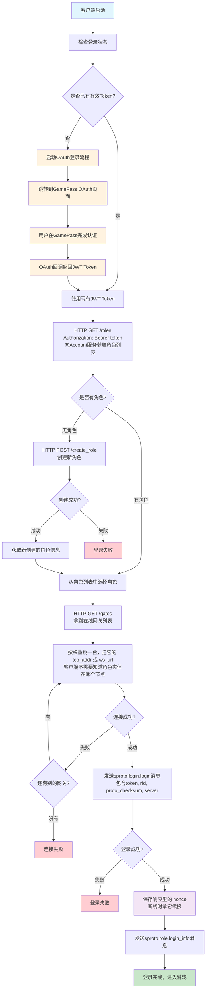
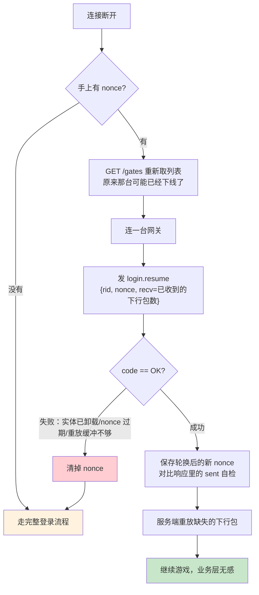
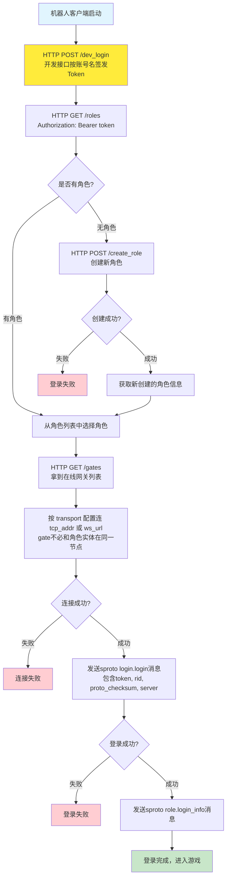
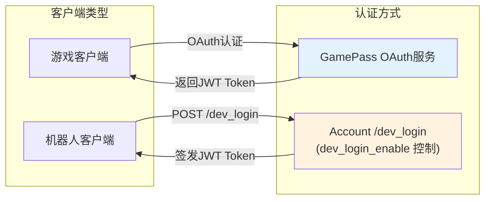
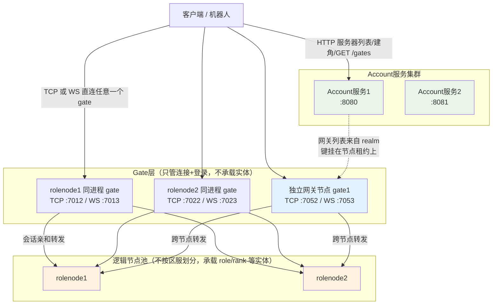
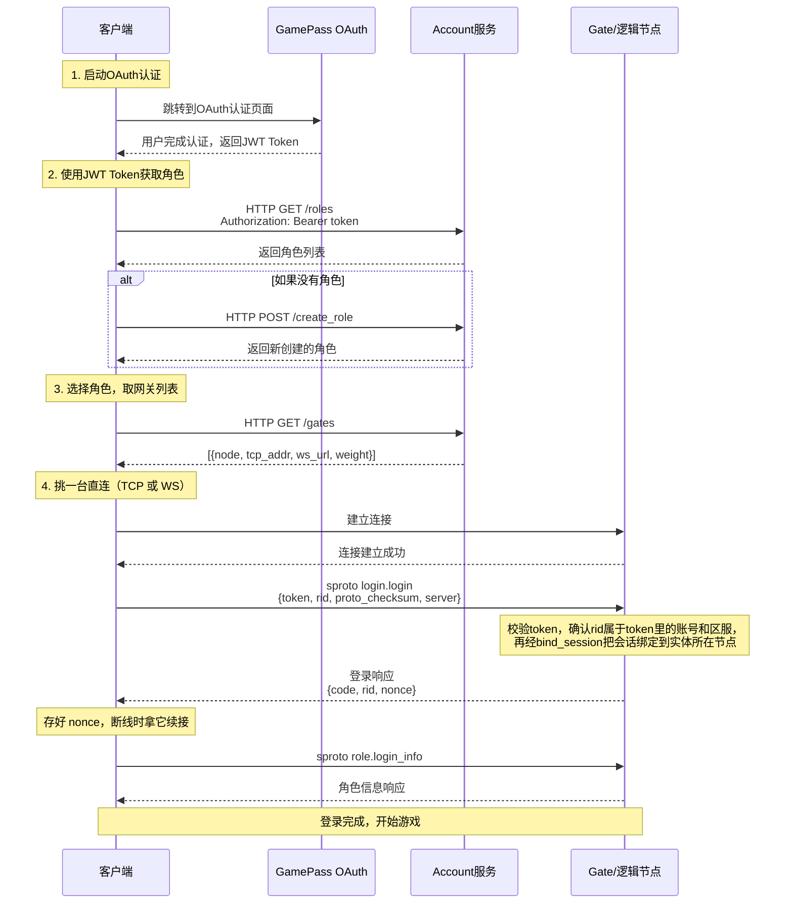
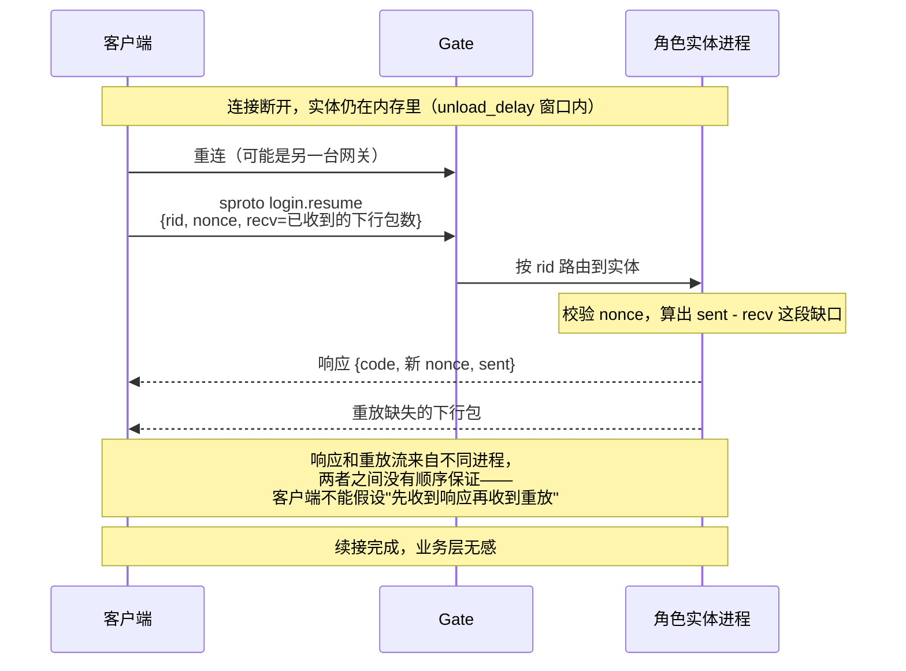
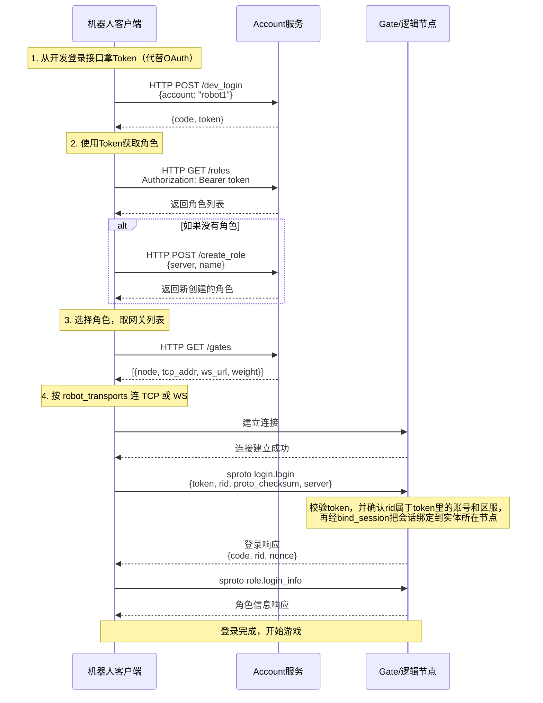

# 登录流程图

本文是[登录流程](login.md)的图示版。要写客户端 SDK 的话，规范在[客户端接入规范](client_protocol.md)，那边有逐条的客户端义务；这里只画链路。

## 概述

两种认证方式，区别只在"token 从哪来"，拿到 token 之后的链路完全一样：

1. **正式客户端**：走 GamePass OAuth 拿 JWT Token
2. **机器人/开发客户端**：向 Account 的 `POST /dev_login` 要 token，正式环境关掉这个接口

> **传输协议说明**：网关节点同时监听 TCP 和 WebSocket 两个端口，分别由 `service/gate_tcp.lua` 和 `service/gate_ws.lua` 承载，两者之上是同一套会话层，协议、登录、续接完全一致。客户端二选一直连即可，中间不需要任何代理。地址不写死在客户端里，由 `GET /gates` 下发。

## 完整登录流程（正式客户端）



## 断线之后：先续接，续不上再重新登录

断线不等于重新登录。实体还在内存里（由实体的 `unload_delay` 决定能等多久）的话，拿 `nonce` 走 `login.resume` 可以把会话接回去，断线期间漏掉的下行包会被重放出来，业务层察觉不到这次断线。



> `resume` 失败的错误码不用分类处理：**任何**失败都是同一个动作——清掉 nonce，走完整登录。续接是优化，不是必需路径。

## 机器人客户端简化流程



## 认证架构



## 服务集群架构



> 网关节点启动时把自己的接入地址写进 realm，键挂在**节点租约**上：进程没了键跟着没，客户端不会被引导到一台已经死掉的网关。停服时的 `stop_accepting` 阶段会主动摘掉自己——已连上的客户端照常走完停服流程，新客户端不再被引导过来。

> 区服（server）→ 逻辑服（game）→ 战区（zone）是**逻辑概念**，存在 etcd 区服目录里，不对应物理节点；逻辑节点池承载所有区服的实体，开服/合服只改目录映射。见[架构概览](../overview.md)。

## 协议交互时序图

### 正式客户端 OAuth 认证流程



### 断线续接时序



### 机器人客户端简化认证流程



## 关键数据结构

### JWT Token

**正式客户端**（通过 GamePass OAuth 获取）：

服务端 `jwt.verify_login`（`example/lualib/jwt.lua`）校验签名、`iss`、`aud` 和时效，业务代码仅使用 `account` 字段：

```json
{
  "account": "user_account_id",
  "iss": "skyext",
  "aud": "skyext-game",
  "iat": 1638360000,
  "exp": 1638360300
}
```

| 字段 | 说明 |
|------|------|
| iss / aud | 签发方与接收方，必须与 `login_jwt_issuer` / `login_jwt_audience` 一致。签名密钥只保证"是我们签的"，这两项保证"是这套服务签的、签给这套服务的"——同一密钥被别的系统或别的用途复用时不会互相串 |
| exp | **必填**，缺失直接拒绝：没有过期时间的登录 token 等于永久有效，一旦泄漏就收不回来。有效期由 `login_jwt_ttl` 决定 |
| iat / nbf | 可选。比较时都放宽 `login_jwt_leeway` 秒，容忍节点间时钟差 |

未知字段会被忽略。GamePass 这类外部签发方必须按上面的 `iss`/`aud` 签，否则服务端会拒绝。

**机器人客户端**（仅用于开发和测试）：向 Account 的 `POST /dev_login` 要 token，接口内部调用 `jwt.sign_login({ account = account })`。机器人自己不持有签名密钥。

`jwt.sign_login` 从配置取密钥和 `iss`/`aud`/`ttl`，自动补上 `iss`、`aud`、`iat`、`exp`。支持的签名算法：`HS256`、`HS512`。`/dev_login` 不校验身份，由 `dev_login_enable` 控制，正式环境必须关掉。

### nonce（续接凭据）

`login.login` 成功后下发，16 字节随机串。每次 `resume` 成功都会轮换一个新的，旧的立即失效——拿同一个 nonce 续接两次，第二次必然失败。客户端存在内存里即可，不需要落盘：进程重启之后实体多半也已经卸载了，续接不回来。

### Account 服务 API

登录 token 一律走 `Authorization: Bearer <token>` 请求头。放在 URL query 里会被写进访问日志和代理日志，等于把凭据明文留在一堆地方。

**网关列表：**

```
GET /gates

Response: { "code": 0, "gates": [{ "node": "gate1", "tcp_addr": "192.168.1.10:7052", "ws_url": "ws://192.168.1.10:7053", "weight": 1 }] }
```

> 不需要登录：这里只有地址，没有任何账号相关的东西。服务端也不替客户端"挑一台"——挑选策略（按区域、按版本、重试下一台）是客户端的事，服务端一旦代为选择，客户端就失去了换一台重试的能力，而这恰恰是断线续接最需要的。地址不要写死在客户端里。

**获取角色列表：**

```
GET /roles[?server=s1]
Authorization: Bearer <jwt_token>

Response: { "code": 0, "roles": [{ "rid": 1, "server": "s1", "name": "..." }] }
```

> `server` 参数可选，传入时仅返回该区服的角色。服务端通过区服目录校验区服是否存在。

**服务器列表：**

```
GET /servers

Response: { "code": 0, "servers": [{ "server": "s1", "name": "一区", "tag": "S1", "status": "open", "open_time": 1700000000, "recommended": true }] }
```

**创建角色：**

```
POST /create_role
Authorization: Bearer <jwt_token>
Body: { "server": "s1", "name": "角色名称" }

Response: { "code": 0, "role": { "rid": 1, "server": "s1", "name": "..." } }
```

> 只能在 `status = "open"` 的服建角；名字在出生服内唯一，重名返回 `NAME_TAKEN`。`max_role_count`（示例为 5）是单个区服的角色上限。
