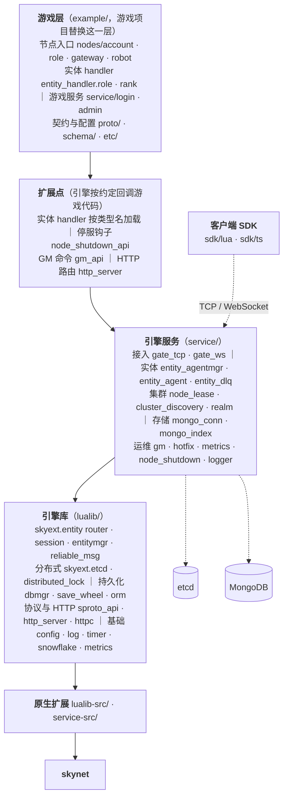
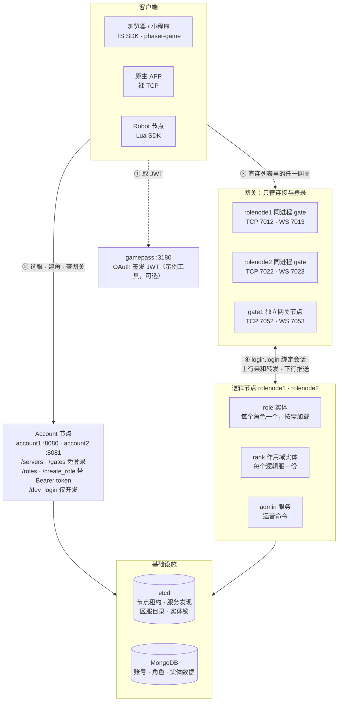

# 架构概览

skyext 在 [skynet](https://github.com/cloudwu/skynet) 上提供通用的游戏服务器基础设施；`example/` 是使用这些能力的示例游戏。本文说明**代码放在哪里、节点如何协作、启动时配置如何生效**。安装、启动和测试步骤集中在[快速上手](getting-started.md)。

## 引擎层与游戏层

| 层级 | 主要路径 | 职责 |
| --- | --- | --- |
| 引擎 Lua 模块 | `lualib/skyext/` | `skyext.*` 命名空间：配置、日志、HTTP、服务发现、协议、GM、实体路由等 |
| 引擎基础设施 | `lualib/orm/`、`lualib/skytest/`、`service/` | ORM、测试框架、GM/热更/数据库等 skynet 服务 |
| 引擎原生扩展 | `lualib-src/`、`service-src/`、`build.mk` | C 模块、C 服务及构建规则 |
| 游戏层（示例） | `example/nodes/`、`example/lualib/` | 节点入口、角色/账号逻辑、实体 handler 与业务模块 |
| 游戏契约与配置 | `example/etc/`、`example/proto/`、`example/schema/`、`example/build/lualib/game/orm/` | 节点/应用配置、sproto/ORM 源模式及生成的游戏层 schema（构建产物） |

游戏项目可以参考 `example/` 实现自身逻辑，并通过搜索路径使用引擎模块。引擎服务通过约定扩展点加载游戏侧代码，例如实体 agent 按实体类型加载 `entity_handler.<type>`；这不等于把业务模块放进 `lualib/skyext/`。`skynet/` 与 `3rd/` 是 Git submodule 依赖；ORM 运行时在主工程 `lualib/orm/`，内化的生成工具在 `scripts/tools/sproto_orm/`，解析器仍为 `3rd/sprotodump` 子模块。框架发布包不分发许可证尚未核实的解析器，重新生成模式需使用初始化子模块的源码检出。

### 框架分层

图中按依赖方向自上而下。游戏代码通过扩展点和 `require "skyext.*"` 使用引擎；引擎不 require 游戏模块，实体 handler 等由引擎按约定名加载。客户端 SDK 跑在客户端进程里，不在服务端，只通过网关的 TCP / WebSocket 接入。测试框架 `lualib/skytest/` 只在测试时加载，未画出。

## 节点与数据流

| 节点 | 入口 | 主要职责 |
| --- | --- | --- |
| Account | `example/nodes/account/main.lua` | 启动 HTTP 服务并注册账号路由，处理服务器列表 / 网关列表 / 角色列表 / 建角 |
| Role | `example/nodes/role/main.lua` | 逻辑节点：启动 gate（同进程部署）+ 登录 + 实体，承载角色连接与游戏逻辑 |
| Gateway | `example/nodes/gateway/main.lua` | 独立网关节点（`start = "gateway"`，实例 `gate1`）：只接客户端连接 + 登录，不承载实体，上行转发到实体所在节点 |
| Robot | `example/nodes/robot/main.lua` | 示例客户端（基于 Lua SDK），在 TCP 与 WebSocket 上各跑一遍登录、业务与断线续接 |

各节点分别运行在 skynet 进程中。示例的 Account、Role、Gateway 节点都调用游戏层 `example/lualib/launcher.lua` 的 `launcher_node`：依次启动 metrics、GM、hotfix，注册停服编排与区服目录服务，并在启动阶段创建 MongoDB 索引；带 `gate_port` 的节点再调 `launcher_gate` 开网关。客户端连任意一个 gate（Role 节点同进程部署的 gate，或独立的 Gateway 节点）都能进游戏：gate 只管会话与拆包，上行按会话转发到实体真正所在的节点（同节点 `skynet.send`，跨节点 `cluster.send`）。服务发现组件把服务注册到 etcd，并为服务端调用方维护节点缓存；示例 Robot 和正式客户端一样，先请求 Account 的 `GET /gates` 拿在线网关列表再直连其中一台（网关地址由各网关节点上报进区服目录，挂在节点租约上；客户端不需要知道实体在哪个节点）。角色与账号数据通过 MongoDB 连接池、ORM 和业务 handler 读取/保存。详细的客户端交互见[登录流程](guide/login.md)及[流程图](guide/login_diagram.md)。

示例业务配置位于 `example/etc/nodes/`：Account HTTP、Role/Gateway 网关、GM HTTP 端口，以及 `mongo_config`、`etcd_config`、JWT 密钥等都在这里配置。跨机器部署时，需同时调整监听/对外地址、服务发现地址和外部服务连接地址；示例中的 `127.0.0.1` 只适用于本机环境。

### 示例部署

Account 读写 MongoDB 里的账号与角色，从 etcd 的区服目录读服务器列表与在线网关；网关把自己的接入地址上报进区服目录（挂在节点租约上，进程没了地址跟着消失）；逻辑节点在 etcd 上持实体锁、做服务发现，实体数据经 ORM 加载并定时回存 MongoDB。节点名在 `example/etc/nodes/*.app.lua` 的 `cluster_node_name` 里，和配置文件名不完全一致（`role1.app.lua` 的节点名是 `rolenode1`）。每个节点另开 GM HTTP（9090–9094）和指标端口（9190–9194）。客户端侧的登录与续接时序见[登录流程图](guide/login_diagram.md)。

## 启动与模块加载

1. skynet 从 `example/etc/<node>.conf.lua` 读取启动参数；节点文件通过 `include "core.conf.lua"` 载入根目录、线程与搜索路径。
2. `example/etc/core.conf.lua` 定义 `root = "./"`、`skyext_root`、`game_root`，再载入同目录的 `paths.conf.lua`。因此直接启动 skynet 时工作目录必须是 **skyext 仓库根目录**。
3. `lualib/loader.lua` 依次配置服务局部、节点、游戏公共、引擎和 skynet 的 Lua 模块搜索路径，并加载 `require "skyext"`。
4. `lualib/skyext/init.lua` 注册初始化回调：`skyext.config` 读取 `app_config_path` 指向的应用配置，`skyext.log` 初始化日志；随后执行服务自身的入口文件。

搜索优先级允许服务或游戏层覆盖自己的模块，但引擎 Lua 模块应通过 `require "skyext.<模块>"` 引用，避免与同名业务模块冲突。`config.get`、`get_number`、`get_boolean`、`get_table` 分别读取字符串、数值、布尔和表类型的应用配置。配置文件和示例见[快速上手：理解并修改配置](getting-started.md)。

## 核心能力与实现位置

| 能力 | 入口或实现 | 说明 |
| --- | --- | --- |
| 节点租约 | `lualib/skyext/node_lease.lua`、`service/node_lease.lua` | 整个节点唯一的 etcd 租约：申请、续租、撤销，失效时广播给实体锁与服务发现 |
| 服务发现 | `lualib/skyext/cluster_discovery.lua`、`service/cluster_discovery.lua` | 把节点键与服务键挂到节点租约上，服务节点查询与变更通知 |
| etcd 客户端 | `lualib/skyext/etcd/` | etcd v3 HTTP 客户端，按 transport/auth/kv/lease/watch 分层，服务发现与分布式锁的底座 |
| 数据持久化 | `lualib/skyext/dbmgr.lua`、`lualib/skyext/save_wheel.lua`、`lualib/orm/`、`service/mongo_conn.lua` | 加载/缓存 ORM 对象、跟踪变更、按回存轮定时与卸载时写入 MongoDB |
| ORM schema 变更 | `lualib/orm/init.lua` 的 `orm.decode`、`lualib/skyext/orm_compat.lua`、`./bin/skyext schema check` | 加载时丢弃已删字段、补齐新字段；改名、改类型、重用删过的名字由基线对比在 CI 拦下；见 [改 ORM schema](guide/orm_schema_change.md) |
| 协议与鉴权 | `lualib/skyext/sproto_api.lua`、`example/lualib/jwt.lua` | sproto 编解码、示例 JWT 登录 |
| HTTP 与 GM | `lualib/skyext/http_server/`、`lualib/skyext/gm_api.lua`、`service/gm.lua` | HTTP 路由、命令注册/执行、token 鉴权；见 [HTTP 服务端](guide/http_server.md)、[GM HTTP API](guide/gm_api.md) |
| 指标 | `lualib/skyext/metrics*.lua`、`service/metrics.lua` | counter/gauge/histogram 原语、跨服务合并与 Prometheus 文本导出；见 [指标采集与导出](guide/metrics.md) |
| 停服 | `service/node_shutdown.lua`、`lualib/skyext/node_shutdown_api.lua` | GM `shutdown` 编排：停止接入 → 卸载实体 → 释放资源 → 撤销节点租约 → 退出；游戏层挂钩子 |
| 热更新 | `service/hotfix.lua`、`example/hotfix/` | 热更包、预演与执行；按[热更新操作](guide/hotfix.md)进行 |
| 通用实体 | `lualib/skyext/entity/`、`service/entity_agent*.lua` | 按存活节点路由（HRW）、粘性转发、实体生命周期、常驻实体与预加载、作用域实体（`scope`）、实体定时器、停服卸载、业务模块扩展 |
| 网关会话 | `service/gate_tcp.lua`、`service/gate_ws.lua`、`lualib/skyext/entity/session.lua`、`example/service/login/` | gate 监听 TCP / WebSocket、拆包、会话表与亲和转发；实体侧会话绑定、上行入队、下行推送与断线续接；登录服务经 `router.bind_session` 把会话绑到实体；见[登录流程](guide/login.md) |
| 客户端 SDK | `sdk/lua/`、`sdk/ts/` | 官方客户端实现（Lua / TypeScript），实现[客户端接入规范](guide/client_protocol.md)；见[客户端 SDK](guide/client_sdk.md) |
| 测试 | `lualib/skytest/`、`scripts/commands/test.lua` | 每个 `.test.lua` 文件独立 skynet 进程 |

**区服**：逻辑节点**不按区服划分**，任何 role 节点都能承载任何区服的角色。作用域分四层：server（出生服）→ game（逻辑服，一起玩的那批人）→ zone（战区，跨服玩法的范围）→ global。映射存在 etcd 的**区服目录**里（`service/realm.lua`，查询用 `skyext.realm`），由 GM 命令 `realm_open`（开服）、`realm_set_zone`（调战区）维护，所有节点 watch，改了即生效，不用改配置、不用重启。**角色只记出生服**，game / zone 每次用 `realm.game_of(server)` 现查，所以合服只改目录里的一条映射，不改任何玩家文档；实体 ID 是全局唯一的 snowflake，合服也不会撞 ID。

一个作用域一份的全局功能做成**作用域实体**：实体类型配 `scope = "game"`（或 `zone`、`global`），按区服目录自动预加载，开服后新 game 的那一份几秒内出现在某个节点上，用 `router.scoped_call(type, value, ...)` 访问。示例的排行榜就是这样。每个功能自己决定作用域并自己检查边界，引擎不拦——跨服玩法需要越界。惯例是**社交可以跨服，经济默认不跨服**（交易、带物品的转赠要求同 game）。需要物理隔离的区服在部署层面单独起一套集群。

**扩缩容不踢人**：节点进出后实体的目标节点会变，但已经加载的实体不会被搬走。发给它的请求由新目标节点转给持锁节点执行（粘性路由），实体在旧节点自然卸载后，下一次加载才落到新节点；只有玩家重新登录时才把实体要过来。细节见[实体系统设计](https://github.com/hanxi/skyext/blob/main/docs/design/entity_system.md)。

**停服**：任何节点都用 GM 命令 `shutdown` 停服，流程由引擎的 `service/node_shutdown.lua` 编排：先回调游戏层的 `stop_accepting` 钩子停止接入（示例 role/gateway 节点在这里关 gate），从服务发现摘掉实体类型，再把全部实体卸载（落库、释放锁、踢下在线玩家）；卸干净后回调 `release` 钩子（snowflake 在这里归还机器号），撤销节点租约（节点键、服务键、残留的实体锁一并从 etcd 消失），最后退出进程。有实体卸不掉就不退出。etcd 里属于本节点的键在退出前都已删除，别的节点不用等租约过期。游戏层用 `skyext.node_shutdown_api.add_hook(phase, cmd)` 挂钩子。**直接杀进程不是停服**：内存里离上次回存（`db_save_interval`，默认 3 分钟）之后的改动会丢，锁也要等租约过期。

**节点崩溃后的接管窗口**：实体锁和服务发现键挂在同一个节点级 etcd 租约上（`service/node_lease.lua`，全节点只此一个），TTL 30 秒、每 10 秒续一次。租约失效时实体隔离与服务发现摘除是同一个事件的两面，不会出现「对外还在服务列表里、对内每个实体都加不上锁」。走 `shutdown` 停服时锁是主动释放的，没有空窗；节点**硬崩**（进程被杀、机器掉电、网络分区）时没人能主动释放锁，必须等 etcd 把租约过期掉。这段时间里，落到该实体上的请求会一直失败（`router.call` 返回 `false, reason`，`bind_session` 返回 `LOCK_FAILED`，能查到持锁节点、交接又失败时返回 `IN_OTHER_NODE`）：接管节点向已死的持有者转发或请求交接都会失败，而锁键还在，抢不过来。

所以**单个实体的最坏不可用时长约 30 秒**，不是秒级。客户端重连逻辑要能容忍这个量级，不要在收到 `LOCK_FAILED` 后立刻放弃或提示玩家"账号异常"。想缩短窗口就得调小 `service/node_lease.lua` 里的 `LEASE_TTL`（现为 30 秒，续租间隔是它的三分之一），代价是心跳更密、对 etcd 抖动更敏感——续租晚一拍就会误判失租，把一个健康节点上的实体全部隔离。

**etcd 是玩法的核心依赖**：每个实体的加载和卸载都要在 etcd 上做一次事务，etcd 的写延迟直接加在登录耗时上，停服维护后的登录高峰也会集中压到 etcd。单次续租失败不会有任何后果：连不上、超时、5xx 都只当成这一拍没续上，下一拍（10 秒后）再试，etcd 的 GC 抖动和 leader 切换都在这个容忍范围内；transport 层还会在一次请求内把集群的其它端点都试一遍。更要紧的是，etcd **连续约 28 秒不可达**（租约 TTL 减去 2 秒余量）时，或者 etcd 明确回答租约已不存在时，节点会判定自己的租约已失效，把所有已加载实体隔离并踢下线——数据不会写坏（fence 挡住了旧持有者），但全服掉线。这是"同一实体绝不同时在两个节点上"这一保证的代价。etcd 要按核心存储部署（至少三节点、独立磁盘、监控 raft 延迟和 leader 切换），不能当成可有可无的服务发现组件。

**数据可靠性边界**：`dbmgr` 对脏数据制作快照，在 MongoDB 确认更新后才清除脏标记；写入失败、不确定或未匹配时保留脏对象及缓存，卸载不得先释放实体锁。进程异常退出时仍不能据此推断数据已持久化；可靠消息为至少一次投递，业务 handler 需以 `msg_id` 幂等处理。生产使用前应结合一致性、失败日志和恢复策略评估。示例 JWT 密钥必须更换，GM token 要现生成并限制接口来源。

## 当前状态与延伸阅读

代码中已有 Account/Role/Gateway 示例、实体框架（含作用域实体）、网关会话层（TCP / WebSocket、断线续接）、Lua / TypeScript 客户端 SDK、GM/热更、skytest 测试框架；[管理后台规划](https://github.com/hanxi/skyext/blob/main/docs/plan/admin_panel.md)和[性能采样设计](https://github.com/hanxi/skyext/blob/main/docs/design/profiler.md)描述的是后续方向，不应将规划中的功能视为已交付。仓库中已有 `public/gm.html` 和部分 profiler 相关组件，但不等于完整的运营后台或火焰图服务。

深入设计见仓库中的[实体系统设计](https://github.com/hanxi/skyext/blob/main/docs/design/entity_system.md)和[skytest 设计](https://github.com/hanxi/skyext/blob/main/docs/design/skytest.md)。这些内部文档**不随在线文档站发布**；本文的链接指向 GitHub 源文件。配置、测试和操作命令请以[快速上手](getting-started.md)为准。
