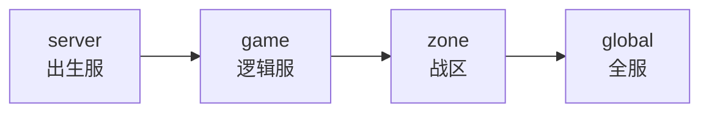
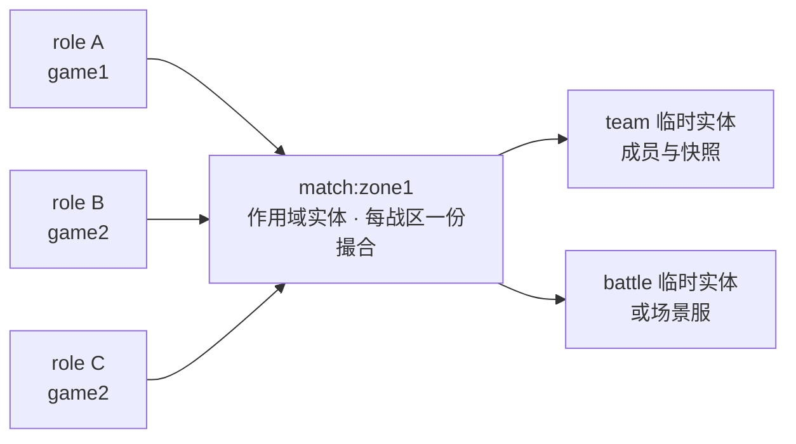

# 架构重构设计：逻辑服 + 共享基础设施

> **状态：分阶段实现中。** 阶段 1–3 已实现：常驻实体与实体定时器、区服目录与作用域实体、独立网关层与会话续接（见下面「已实现的部分」）。本文余下内容——合服编排、无感迁移、频道与广播、临时实体与不唤醒调用、跨服玩法范式、跨实体事务——都还只是设计，代码里没有。
>
> 分层约定：通用机制放 skyext 框架层，具体玩法与产品取舍（名字规则、服务器列表、排行榜）放 example。
> 方向：按「第三代」区服模型建设——服只是玩法标签，玩家数据放在共享集群里；引入独立网关层，同时保留 gate 与逻辑同进程的小规模部署。

## 目标

一个面向「以玩家数据为中心」游戏（SLG、卡牌、放置、休闲 MMO）的服务器框架，要同时满足：

1. **开服、合服是运营操作，不是工程操作**：开新服不加机器、不重启；合服不搬数据、不停机。
2. **跨服是常态**：跨服匹配、跨服组队、跨服战场、跨服排行，用的是和本服功能同一套机制，只是作用域更大。
3. **玩家数据只有一个家**：任何玩法都不复制可写的玩家数据。跨服活动持有的是引用和只读快照，结果靠可靠消息写回。
4. **逻辑节点可以随时重启**：发版、扩容、迁机器都不踢玩家。

目标 1 的开服、目标 2 的作用域底座、目标 4 的「客户端不绑定逻辑节点」已经落地；合服、跨服玩法、实体迁移还没有。

## 已实现的部分

| 内容 | 现行文档 |
|------|----------|
| **区服目录**：`server → game → zone` 映射存 etcd（`service/realm.lua`），查询用 `skyext.realm`，GM 命令 `realm_open`（开服）、`realm_set_zone`（调战区）维护，所有节点 watch。角色文档只存出生服 `server`，game / zone 每次用 `realm.game_of(server)` 现查；角色名在出生服内唯一（`example/lualib/role_name_api.lua`，`(server, name)` 唯一索引），跨服显示为 `[S3]张三`；Account 的 `/servers`、`/gates` 从目录读 | [架构概览](../overview.md)、[登录流程](../guide/login.md#区服目录) |
| **常驻实体与作用域实体**：`resident`、`preload`、实体定时器；`scope = "game" \| "zone" \| "global" \| "server"` 的类型每个作用域取值一份，ID 由 `types.scoped_id(type, value)` 算出（任何节点直接算，不查表），`entity_agentmgr` 按区服目录每 3 秒对一轮预加载，开服后新 game 的那一份自动出现；访问用 `router.scoped_call / scoped_send`。示例排行榜就是 `scope = "game"` 的常驻实体 | [实体系统设计](../design/entity_system.md) |
| **独立网关层**：`service/gate_tcp.lua`（2 字节长度前缀）与 `service/gate_ws.lua`（WebSocket 二进制帧）只管连接与拆包，会话表 `fd -> { owner_node, owner_service }`，上行按会话亲和转发到实体所在节点（同节点 `skynet.send`，跨节点 `cluster.send`），不解码协议。登录在网关侧完成（`example/service/login/`，经 `router.bind_session` 绑定），实体侧会话是 `skyext.entity.session`，下行用 `session.push(entity, name, msg)`。gate 可与实体同进程部署（role 节点），也可独立成节点（`example/nodes/gateway/`，`start = "gateway"`，实例 `gate1`）；断线续接 `login.resume` 跨连接保留会话 | [架构概览](../overview.md)、[登录流程](../guide/login.md)、[客户端接入规范](../guide/client_protocol.md) |

节点、端口与数据流见[架构概览的「示例部署」](../overview.md#示例部署)。

---

## 一、作用域模型

引擎不规定「玩家只能和同 game 的人交互」。作用域分四层，每个全局功能在设计时选一层，并由功能自己检查边界——跨服玩法需要越界，引擎拦不得。业界惯例：**社交可以跨服，经济默认不跨服**。



| 功能 | 作用域 | 边界检查 |
|------|--------|----------|
| 排行榜、公会、世界聊天 | game | 天然隔离：按 game 各起一份作用域实体 |
| 交易、拍卖、带附件的转赠 | game | 发起时检查双方同 game，防止一个服的通胀扩散 |
| 跨服匹配、跨服战场、跨服排行 | zone | 按 zone 各起一份作用域实体 |
| 好友、私聊 | global | 不检查（通常要求先加好友） |
| 全服公告、全服邮件 | global | — |

四层的含义、目录结构和查询 API 见[架构概览](../overview.md)。

## 二、合服

合服只改区服目录里的一条 `server → game` 映射，不改任何玩家文档——这是第三代模型的核心收益。要补的是作用域实体那一侧：

- 目录把 game3 并入 game2 后，引擎对每个 `scope = "game"` 的类型调用 handler 的 `on_merge(target_entity, source_id)`，比如把 game3 排行榜的条目并进 game2，再归档源实体。
- 整个流程由 GM 命令 `realm_merge` 编排，过程中源 game 的作用域实体拒绝写入。
- 角色名在出生服内唯一，合服不会撞名，不需要强制改名；实体 ID 是全局唯一的 snowflake，也不会撞 ID。

## 三、无感迁移（逻辑节点滚动发版）

现在实体要离开当前节点时（停服、交接），会连带踢掉客户端（`entitymgr` 卸载时调 `session.unbind_kick`），玩家得重登。目标是把这一步换成会话迁移：

1. 实体卸载前通知网关 `migrate(fd)`；网关暂停这个会话的上行，把收到的包缓存起来。
2. 实体落库、释放锁。
3. 网关重新调用 `router.bind_session`，实体在 HRW 指向的新节点上加载。
4. 网关按顺序回放缓存的包，恢复转发。

玩家只感到一次几十到几百毫秒的卡顿，不会掉线重登。停服编排（`service/node_shutdown.lua`）的卸载阶段相应改为「迁移会话后卸载」。

**代价**：迁移窗口里网关要缓存上行包，缓存撑爆只能断开连接，退化成客户端重连续接；新节点加载失败时要能把会话绑回原节点。

## 四、频道与广播

广播的对象是在线连接，连接在网关上，所以频道也挂在网关层。频道名就是作用域键：

| 频道 | 用途 |
|------|------|
| `game:game1` | 本服世界聊天、本服公告 |
| `zone:zone1` | 战区公告、跨服活动开启通知 |
| `global` | 全服公告 |
| `guild:<id>`、`team:<id>` | 公会、队伍频道 |

- 每个网关维护 `频道 -> 本地会话集合`；会话登录时按出生服自动订阅 `game:` / `zone:` / `global`，目录变化（合服、调战区）时由 `realm.subscribe` 触发重新订阅。
- 公会、队伍频道由实体发起订阅（加入队伍时，队伍实体通知各成员会话所在的网关），断线自动退订。
- 发布：新增 `skyext.channel` 的 `channel.publish(name, msg)`，发给全部在线网关（网关列表取自区服目录 `realm.gates()`），各网关只投递给本地订阅者。

## 五、临时实体与不唤醒调用

跨服玩法里大量对象是短命的：队伍、匹配中的房间、一场战斗。它们需要「同一时刻只在一个地方」，但不需要（也不该）落库。

### 临时实体

```lua
entity_types.team = {
    persistent = false,   -- 只在内存，不读写 Mongo
    auto_create = true,
    unload_delay = 60,    -- 最后一个成员离开后多久销毁
}
```

- 仍然用 etcd 锁保证单活（两个节点不会各有一份同一个队伍）。
- 节点崩溃时临时实体直接丢失，由参与方超时处理（队伍解散、战斗判无效）。这和业界做法一致：跨服队伍、房间都不持久化。

### 不唤醒调用

`router.call` 发给离线玩家会把他的整份数据从 Mongo 加载进来：查 100 个好友的在线状态就会加载 100 个离线角色。

新增 `router.call_loaded` / `router.send_loaded`：只投递给当前已经加载的实体，没加载就返回 `false, "offline"`，绝不触发加载。粘性路由内部已经有 `entity_call_loaded` 入口，这里是把它变成公开 API。在线状态、跨服邀请、队伍推送都用它。

## 六、跨服玩法范式：以跨服组队为例

所有跨服玩法都按同一个模式搭：**作用域实体负责撮合，临时实体负责活动，玩家实体始终是自己数据的唯一写入者。**



1. **报名**：role 实体把自己的**只读快照**（等级、战力、出生服、显示名）发给 `match:zone1`。快照只用于匹配和展示，过期就重取。
2. **组队**：匹配成功后创建 `team:<id>` 临时实体，记录成员 rid 和快照；各成员 role 实体在内存里记下 `team_id`，并订阅 `team:<id>` 频道。
3. **活动中**：队伍、战斗实体只读快照、只改自己的状态。需要给玩家推送时走频道或 `send_loaded`。
4. **结算**：奖励、积分通过**可靠消息**发回各成员的 role 实体，按 `msg_id` 去重。成员离线也能在下次登录时收到。
5. **边界检查**：`match:zone1` 只接受 `realm.zone_of(realm.game_of(role.server)) == "zone1"` 的报名，由功能自己检查。

这个模式下不会出现「一个角色两份可写数据」：跨服活动无论怎么组合，玩家数据都只在 role 实体里改。

## 七、跨实体事务

实体加载期间内存是权威、数据库只是快照，所以不能靠 Mongo 多文档事务保证跨实体一致。跨实体操作一律通过可靠消息 + 幂等完成：

- **单向转移**（赠送、发奖励、邮件附件）：发起方先扣，再 `reliable_send` 给接收方加。按作用域表，**带物品的转移要检查双方同 game**。
- **双向交换**（交易）：一个交易实体做协调者，持久化状态机：向双方发 `reserve` 冻结物品 → 都成功则发 `commit`，任一失败或超时则发 `release`。每一步都是可靠消息，交易实体重启后从持久化状态继续。框架提供 `skyext.entity.saga` 帮助库。

---

## 待补的基建

| 模块 | 改造 |
|------|------|
| 实体系统 | `persistent = false`（临时实体）；`router.call_loaded` / `router.send_loaded`；作用域实体的 `on_merge` 合服钩子 |
| 网关 | 会话 `migrate`：暂停上行、缓存回放，接入停服编排与实体交接 |
| 频道 | 新增 `skyext.channel`，挂在网关层 |
| 事务 | 新增 `skyext.entity.saga` |
| GM | `realm_merge`（合服） |
| 示例 | 跨服匹配 + 组队；交易 |

## 推进顺序

| 阶段 | 内容 | 依赖 |
|------|------|------|
| 4 | 无感迁移：会话 `migrate` 接入停服与交接；滚动发版验证 | — |
| 5 | 频道与广播（按作用域自动订阅） | — |
| 6 | 临时实体、`call_loaded`；跨服匹配 + 组队示例 | 5 |
| 7 | 合服编排（`realm_merge`、`on_merge` 钩子）；saga 帮助库与交易示例 | — |

阶段 4、5、7 互不依赖，可以并行。

## 不在本次范围

- **场景与 AOI**：实时同步类玩法需要按空间分片的场景服，与「按 ID 寻址的实体」是不同模型。跨服战场里的实时战斗部分属于这一类，本设计只负责把玩家撮合进去、把结果写回来。
- **etcd 不可用时的降级**：etcd 连续约 28 秒不可达会全服掉线（见[架构概览](../overview.md)）。区服目录也在 etcd 里，etcd 的重要性因此更高，降级方案需要单独评估。
- **Mongo 分片**：玩家数据量到一定规模后按 `rid` 哈希分片。实体系统按 ID 读写、没有跨文档查询，天然适合分片，届时只是部署层面的事。
